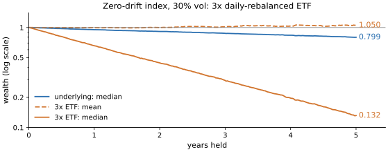
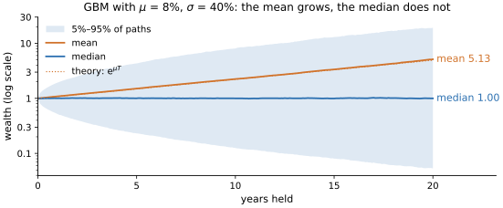
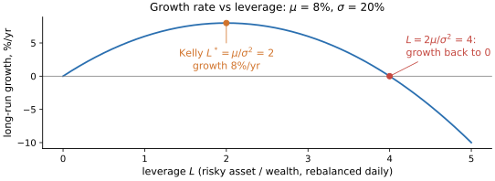

# Lab 00 · 收益与复利

> 难度 ★☆☆☆☆ · 预计 2–3 小时 · 前置：概率论基础

这个 lab 讲的东西看起来最简单，但它决定了你后面看到的每一个数字是不是可信：
同一段净值，“平均收益”可以是正的，钱却在变少；一个期望收益很好的资产，大多数持有人却亏钱；
一个看起来无害的“每日再平衡 3 倍杠杆”，在震荡市里会把钱慢慢磨光。

本 lab 由三部分组成，形式和 [lab03](../lab03_backtest_statistics/) 一样：

1. **讲义**（本文件）。
2. **审计**（[`audit.py`](audit.py)）：一份准备发给客户的基金月报代码，里面有让数字和真实业绩对不上的错误。
3. **思考题**。

现成实现在 `quantlab.returns` 里。

---

## 1. 两种收益，各自在哪里可加

简单收益 $r_t = P_t/P_{t-1} - 1$，对数收益 $\ell_t = \ln(P_t/P_{t-1}) = \ln(1 + r_t)$。
其中 $P_t$ 是第 $t$ 期期末的价格（或净值，必须是复权后的，见 §6），$t$ 是期数（日、月……，取决于数据频率）。
下面 $R_{0\to T}$ 表示从第 0 期到第 $T$ 期的累计简单收益；$i$ 是资产编号，$r_i$ 是资产 $i$ 同一期的简单收益，
$w_i$ 是资产 $i$ 在组合中的期初权重（占组合价值的比例，$\sum_i w_i = 1$）。

- **时间上，对数收益可加**：$\ln(P_T/P_0) = \sum_t \ell_t$。简单收益要连乘：$1 + R_{0\to T} = \prod_t (1 + r_t)$。
- **横截面上，简单收益可加**：组合收益 $r_p = \sum_i w_i r_i$（$w$ 是期初权重）。对数收益不行：
  $\ln(1 + \sum_i w_i r_i) \ne \sum_i w_i \ln(1 + r_i)$。

所以惯例是：**跨时间聚合用对数收益，跨资产聚合用简单收益**。把两者搞反，是业绩报表里最常见的错误之一，
而且错误的方向往往是让数字更好看（审计题里你会看到）。

$r$ 很小时 $\ell \approx r - r^2/2$，两者几乎相同；日收益层面混用误差很小，但误差会随时间**累积**，
而且累积的方向是固定的——这就是下一节的波动拖累。

## 2. 算术平均与几何平均：波动拖累

一个资产每天交替 +10% 和 −10%，算术平均收益是 0，但每两天净值乘以 $1.1 \times 0.9 = 0.99$，一直在缩水。
同样的算术平均 0，每天交替 ±2% 时一年（252 天）后净值是 $(1-0.02^2)^{126} \approx 0.951$，交替 ±5% 时是 $0.730$：
波动是 2.5 倍，损耗约是 5.5 倍（约等于波动的平方之比）。

一般地，如果每期收益的均值是 $\mu$、方差是 $\sigma^2$，那么长期的**几何**平均增长率约为

$$
g \approx \mu - \frac{\sigma^2}{2}
$$

| 符号 | 含义 |
| --- | --- |
| $r$ | 单期简单收益（随机变量） |
| $\mu$ | 单期简单收益的期望 $\mathbb{E}[r]$，即**算术**平均收益 |
| $\sigma^2$ | 单期简单收益的方差，$\sigma$ 是波动率 |
| $g$ | 单期的**几何**平均增长率 $\mathbb{E}[\ln(1+r)]$：长期下财富按 $e^{g}$ 每期复合增长 |

三者的时间单位要一致：$\mu$、$\sigma$ 用年化值，$g$ 就是年化的几何增长率（约等于 CAGR 的对数形式）；
用日频值，$g$ 就是日频的。

推导：对 $\ln(1+r)$ 在 0 处做二阶泰勒展开，$\mathbb{E}[\ln(1 + r)] \approx \mathbb{E}[r] - \tfrac12\mathbb{E}[r^2]$；
而 $\mathbb{E}[r^2] = \sigma^2 + \mu^2 \approx \sigma^2$（$\mu^2$ 是更高阶的小量），所以 $g \approx \mu - \tfrac12\sigma^2$。
真正决定你长期财富的是 $g$，不是 $\mu$。$\sigma^2/2$ 这一项叫**波动拖累**（volatility drag）。

它的现实含义：

- **“平均年化收益”这个说法是有歧义的。** 算术平均（把每年收益加起来除以年数）总是大于等于几何平均（CAGR）。
  营销材料喜欢用前者。对一个波动 30% 的产品，两者差约 4.5 个百分点。
- **杠杆 ETF 的衰减。** 每日再平衡的 $L$ 倍杠杆 ETF（每天的收益是标的当天收益的 $L$ 倍），
  几何增长率约为 $L\mu - L^2\sigma^2/2$：算术收益放大 $L$ 倍，方差放大 $L^2$ 倍。这里忽略了融资成本和管理费。
  杠杆把波动拖累放大了 $L^2$ 倍，所以在没有趋势的震荡市里，3 倍杠杆 ETF 会稳定地亏钱，
  即使标的最后回到原点。在合成数据上模拟（零漂移、年化波动 30%，2 万条路径）：

  | 持有期 | 标的中位数净值 | 3x ETF 中位数净值 | 3x ETF 平均净值 | 3x ETF 亏损比例 |
  | --- | --- | --- | --- | --- |
  | 1 年 | 0.956 | 0.666 | 1.007 | 68% |
  | 5 年 | 0.799 | 0.132 | 1.050 | 84% |

  理论几何增长率：标的 −4.5%/年，3x ETF −40.5%/年。平均净值仍在 1 附近，是因为少数极端路径撑起了均值——下一节的主题。

  

  *图：同一组模拟（零漂移、年化波动 30%、2 万条路径）在 5 年里的走势，纵轴是对数刻度。蓝线是标的的中位数净值，
  缓慢下滑到 0.799，这是 1 倍的波动拖累；橙色实线是 3 倍 ETF 的中位数，按 $L^2 = 9$ 倍的拖累一路滑到 0.132；
  橙色虚线是 3 倍 ETF 的**平均**净值，始终在 1 附近（期末 1.050）。均值和中位数的差距越拉越大：
  “平均来看不亏”的产品，84% 的持有者 5 年后是亏钱的。*
- **降低波动本身就能提高长期收益**（在 $\mu$ 不变的前提下）。这是分散化和再平衡能“创造”收益的来源。

## 3. 期望与中位数：遍历性问题

几何布朗运动（GBM）$dS/S = \mu\,dt + \sigma\,dW$ 的解是

$$
S_T = S_0 \exp\!\left((\mu - \tfrac12\sigma^2)T + \sigma W_T\right)
$$

| 符号 | 含义 |
| --- | --- |
| $S_t$ | $t$ 时刻的价格；$S_0$ 是初始价格，$S_T$ 是持有到期末 $T$ 时的价格 |
| $T$ | 持有期长度，单位是**年** |
| $\mu$ | 漂移：年化的**算术**期望收益率（瞬时收益率的期望） |
| $\sigma$ | 年化波动率 |
| $W_t$ | 标准布朗运动，$W_T \sim N(0, T)$，代表随机冲击 |
| $dS$、$dt$、$dW$ | 价格、时间、布朗运动在一个无穷小时间段内的变化 |

$\ln S_T$ 服从均值 $\ln S_0 + (\mu - \sigma^2/2)T$、方差 $\sigma^2 T$ 的正态分布，所以 $S_T$ 是对数正态的。
$\mathbb{E}[S_T] = S_0 e^{\mu T}$（对数正态的均值要加上 $\tfrac12\sigma^2T$），而**中位数**是 $S_0 e^{(\mu - \sigma^2/2)T}$
（对数正态的中位数就是 $e^{\text{对数的均值}}$）。
当 $\mu < \sigma^2/2$ 时，期望财富指数增长，但中位数在缩水：**大多数路径亏钱，平均值被少数极端幸运的路径撑起来。**

在合成数据上模拟一个 $\mu = 8\%$、$\sigma = 40\%$ 的资产持有 20 年（2 万条路径）：期末平均财富 5.13
（理论 $e^{0.08 \times 20} = 4.95$），中位数 1.00（理论 $e^{(0.08-0.08) \times 20} = 1$），**一半的路径亏钱**，
而最好的 1% 路径贡献了全部财富的 32%。



*图：同一个资产 20 年里的财富分布，纵轴是对数刻度。浅蓝色带是 5% 到 95% 分位之间的路径（期末从 0.05 到 19.2），
蓝线是中位数，始终在 1 附近；橙线是平均财富，沿着理论值 $e^{\mu T}$（点线）指数增长到 5.13。
平均值越来越被带子顶端那少数路径决定，而一个典型投资者经历的是中间那条线。*

“期望收益为正”对一个只能活一次的投资者意义有限。你经历的是一条路径，不是所有平行宇宙的平均。
这被称为**遍历性**（ergodicity）问题：时间平均（你一个人长期的结果）不等于总体平均（所有人在同一时刻的平均）。

它直接引出**最优杠杆**：以固定杠杆 $L$ 持有（每天再平衡，使风险资产始终是净值的 $L$ 倍，无风险利率和融资成本取 0），
长期增长率 $g(L) = L\mu - \tfrac12 L^2\sigma^2$，
在 $L^* = \mu/\sigma^2$ 时最大（Kelly 准则），在 $L = 2\mu/\sigma^2$ 时降为 0。
例如 $\mu = 8\%$、$\sigma = 20\%$ 时最优杠杆是 2 倍，4 倍杠杆的长期增长率就降到 0。超过最优杠杆不仅更危险，
而且长期收益**更低**。实践中 $\mu$ 估不准（见下一节），所以人们通常只用半个 Kelly 甚至更少。



*图：$\mu = 8\%$、$\sigma = 20\%$ 时，长期增长率 $g(L) = L\mu - \tfrac12 L^2\sigma^2$ 随杠杆的变化。
它是一条开口向下的抛物线：在 $L^* = 2$ 处达到最高的 8%/年，到 $L = 4$ 时回到 0，5 倍杠杆是 −10%/年。
最优点附近曲线很平，所以少用一点杠杆损失很小；越过最优点之后却下降得越来越快——这就是宁可低于 Kelly 的原因。*

## 4. σ 好估，μ 几乎估不出来

从 $n$ 期对数收益估计参数，均值的标准误是 $\sigma_{\text{每期}}/\sqrt{n}$，年化后是

$$
\mathrm{SE}(\hat\mu) = \frac{\sigma}{\sqrt{T_{\text{年}}}}
$$

其中 $\hat\mu$ 是年化漂移的估计值，$\sigma$ 是年化波动率，$T_{\text{年}} = n / m$ 是数据覆盖的年数，
$n$ 是观测期数，$m$ 是每年的期数（日频 252）。推导：每期均值的标准误 $\sigma_{\text{每期}}/\sqrt{n}$ 乘以 $m$ 年化，
再用 $\sigma_{\text{每期}} = \sigma/\sqrt{m}$ 代入，得到 $\sigma\sqrt{m}/\sqrt{n} = \sigma/\sqrt{T_{\text{年}}}$。

**它只取决于数据覆盖了多少年，和采样频率无关。** 把日频换成分钟频，$n$ 增大 240 倍，每期波动也小了 $\sqrt{240}$ 倍，两者正好抵消。
10 年数据、20% 波动，$\hat\mu$ 的标准误约 6.3%——比你想估计的 8% 还大。

在合成数据上模拟验证（10 年 GBM，$\mu = 8\%$、$\sigma = 20\%$，日频与每天 240 分钟的分钟频各估计 100 次）：

| 采样频率 | $\hat\mu$ 的标准差 | $\hat\sigma$ 的标准差 |
| --- | --- | --- |
| 日频 | 0.0652 | 0.00284 |
| 分钟频 | 0.0666 | 0.00017 |

$\hat\mu$ 的精度几乎没变（理论值 0.0632），$\hat\sigma$ 的精度提高了十几倍。

波动率则相反：它的估计精度随观测次数提高（$\mathrm{SE}(\hat\sigma) \approx \sigma/\sqrt{2n}$，正态收益下成立；
$\sigma$ 年化则标准误也是年化的，$n$ 仍是观测期数，所以采样越密越准），
高频数据能把它估得非常准。

这个不对称性贯穿整个量化领域：

- **风险是可以测量和预测的，收益几乎不能。** 这就是为什么风险模型（lab07）比收益预测成熟得多，
  也是为什么很多组合方法（最小方差、风险平价，lab05）刻意回避估计期望收益。
- 任何依赖 $\hat\mu$ 的决策（Kelly 杠杆、均值方差优化）都会被估计误差严重影响。

## 5. 再平衡与买入持有

每期再平衡到固定权重的组合，几何增长率约为

$$
g_{\text{reb}} \approx \sum_i w_i \mu_i - \tfrac12 w^\top \Sigma w
$$

| 符号 | 含义 |
| --- | --- |
| $i$ | 资产编号，共 $N$ 个资产 |
| $w_i$ | 资产 $i$ 的目标权重，每期都再平衡回这个值；$w$ 是由 $w_i$ 组成的 $N$ 维列向量，$\sum_i w_i = 1$ |
| $\mu_i$ | 资产 $i$ 的年化**算术**期望收益 |
| $\sigma_i^2$ | 资产 $i$ 收益的年化方差 |
| $\Sigma$ | $N \times N$ 的年化协方差矩阵，对角线是 $\sigma_i^2$，非对角线是 $\sigma_i\sigma_j\rho_{ij}$（$\rho_{ij}$ 是相关系数） |
| $w^\top \Sigma w$ | 组合收益的方差 |
| $g_{\text{reb}}$ | 再平衡组合的年化几何增长率 |

这是 §2 的 $g \approx \mu - \sigma^2/2$ 应用到整个组合上：组合的算术收益是 $\sum_i w_i\mu_i$，方差是 $w^\top\Sigma w$。

而组合方差 $w^\top\Sigma w$ 小于各资产方差的加权平均 $\sum_i w_i\sigma_i^2$（只要资产不完全相关）。
各资产自己的几何增长率加权平均是 $\sum_i w_i(\mu_i - \sigma_i^2/2)$，它与 $g_{\text{reb}}$ 的差
$\tfrac12\left(\sum_i w_i\sigma_i^2 - w^\top\Sigma w\right)$ 就是**再平衡收益**（也叫分散化收益）：低相关、高波动的资产之间再平衡，能把“各自都不增长”的资产组合成一个增长的组合。

但它不是免费午餐：再平衡本质上是**卖出涨了的、买入跌了的**，是一种均值回复的押注。
如果资产之间的长期收益差异很大（一个持续上涨、一个持续下跌），买入持有让赢家的权重自然变大，
反而更好。再平衡还有交易成本和税。

在合成数据上模拟两只不相关、波动 40% 的资产 50/50 持有 20 年：两者都零漂移时，每日再平衡的中位数净值 0.43、
买入持有 0.31，再平衡在 77% 的情况下胜出；漂移分别为 +15% 和 −5% 时，再平衡中位数 1.17、买入持有 1.88，
再平衡只在 34% 的情况下胜出。

## 6. 这些工具的局限

- **GBM 假设收益 iid 正态、波动恒定。** 真实收益有肥尾（极端日子比正态多得多）、波动聚集（大波动之后是大波动）。
  $\mu - \sigma^2/2$ 依赖的二阶近似在大波动下不够准；肥尾让“大多数路径亏钱”的情况更严重。
- **价格不等于收益。** 股票有分红、拆股，必须用**复权价**或总收益指数；期货有展期；跨币种要算汇率。
  用未复权价格算收益，分红日会出现虚假的暴跌。
- **交易日与日历日。** 日频数据一年约 252 行（A 股约 242–244 行），不是 365 行；年化时口径要和数据频率一致。

---

## 审计

打开 [`audit.py`](audit.py)。这是一段生成基金月报的代码：总收益、年化收益、年化波动、月度收益表，扣除管理费后展示。

1. **先不要跑测试。** 读代码，把发现的问题写进文件开头的「审计记录」。
2. 逐个修正。
3. 运行 `make test LAB=00`，看看漏了什么。

核对任何业绩数字的通用办法：**汇总出来的数字必须能还原出期初到期末的净值变化**——
累计收益、年化收益、分月收益，复利回去都要等于同一个期末净值。

## 思考题

1. 一只基金宣传“过去 10 年平均年化收益 15%”。你需要再知道哪个数字，才能判断投资者实际赚了多少？
   如果它的年波动是 35%，CAGR 大约是多少？
2. 为什么说“期望收益为正、但中位数亏钱”的赌局，对个人投资者和对一家同时做成千上万笔独立交易的机构，意义不同？
3. 第 3 节的例子里最优杠杆是 2 倍。为什么现实中几乎没有人按 Kelly 杠杆满仓？用第 4 节的结论解释。
4. 再平衡收益来自“卖出赢家、买入输家”。这笔收益的对手方是谁？在什么样的市场里它会消失？

## 拓展：真实数据

```python
from quantlab import realdata, returns

px = realdata.index_daily("sh000300")["close"]
mu, sigma = returns.annualize_log_stats(returns.log_returns(px))
```

算一下沪深300的 $\hat\mu$、$\hat\sigma$、$\hat\mu$ 的 95% 置信区间，以及算术年化和 CAGR 的差。
再用 `realdata.a_share_daily` 下载一只股票的**未复权**价格（`adjust=""`），找出分红日的“虚假暴跌”。

## 参考文献

- Peters, O. (2019). *The ergodicity problem in economics.* Nature Physics.
- Kelly, J. L. (1956). *A New Interpretation of Information Rate.* Bell System Technical Journal.
- Booth, D. & Fama, E. (1992). *Diversification Returns and Asset Contributions.* Financial Analysts Journal.
- Cheng, M. & Madhavan, A. (2009). *The Dynamics of Leveraged and Inverse Exchange-Traded Funds.* Journal of Investment Management.
- Merton, R. (1980). *On Estimating the Expected Return on the Market.* Journal of Financial Economics.
