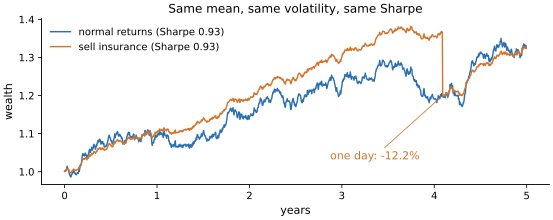
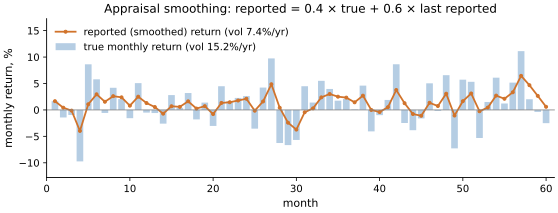

# Lab 01 · 风险指标藏住了什么

> 难度 ★☆☆☆☆ · 预计 2–3 小时 · 前置：lab00

每一个风险指标都是把一整条收益序列压缩成一个数字，而压缩一定会丢东西。
这个 lab 不教你怎么算 Sharpe、回撤、VaR（`quantlab.risk` 里都有），而是让你知道：
**每个数字假设了什么、看不见什么、以及怎样被（有意或无意地）做得好看。**

本 lab 由三部分组成，形式和 [lab03](../lab03_backtest_statistics/) 一样：

1. **讲义**（本文件）。
2. **审计**（[`audit.py`](audit.py)）：一份给投委会的风险仪表盘，里面有让风险看起来更小的错误。
3. **思考题**。

---

## 1. 波动率和 Sharpe 假设了什么

年化波动 $\sigma\sqrt{252}$ 和 Sharpe $\mu/\sigma\cdot\sqrt{252}$（这里 $\mu$、$\sigma$ 是**日收益**的样本均值和标准差，
标准差用 $n-1$ 作分母；严格地说 Sharpe 的分子应是超过无风险利率的超额收益，本课默认无风险利率为 0）隐含了三个假设：

1. **收益是对称的**：上涨的波动和下跌的波动同样“糟糕”。
2. **二阶矩足以描述风险**：分布接近正态，尾部不比正态更厚。
3. **收益在时间上独立**：$\sqrt{252}$ 的年化依赖于此。如果收益有正自相关，真实的年波动大于 $\sigma_{\text{日}}\sqrt{252}$；有负自相关则小于它。

三个假设在真实策略上经常同时不成立。最典型的反例是**卖出期权**（或任何“卖保险”式的策略）：
平时每天稳定赚一点权利金，波动很低，Sharpe 很高；直到某一天市场暴跌，一次亏掉几年的利润。
在一段没有发生暴跌的历史上，它的 Sharpe、波动、回撤看起来都比正态策略好。

在合成数据上模拟两个 5 年策略，均值和波动完全相同（于是 Sharpe 也相同），一个收益正态，
一个卖保险（这 5 年里恰好遇到一次大亏）：

| 指标 | 正态 | 卖保险 |
| --- | --- | --- |
| Sharpe | 0.928 | 0.928 |
| 年化波动 | 6.3% | 6.3% |
| 最大回撤 | 9.4% | 13.3% |
| 95% CVaR（单日） | 0.8% | 0.6% |
| 99% CVaR（单日） | 1.16% | 1.45% |
| 偏度 | −0.07 | −23.2 |
| 超额峰度 | 0.28 | 716 |

Sharpe 和波动完全一样，风险却截然不同。注意卖保险策略的 95% CVaR 反而**更低**：
它的尾部集中在极少数日子里，95% 的置信水平还没“看到”那一天，到 99% 才看到。



*图：表中两个策略的净值。两者的日收益均值和标准差完全相同，所以 Sharpe 都是 0.93。蓝线（正态收益）
每天都有涨有跌，回撤分散在整段路径里；橙线（卖保险）大部分时间几乎是一条平滑上升的直线，
直到第 4.1 年那一天亏了 12.2%，净值从 1.37 跌回 1.20——回到了两年前的水平，一天抹掉了两年的收益。只看 Sharpe 和波动，这两条曲线是“同一个策略”。*

**Sharpe 不随杠杆变化**：把策略加两倍杠杆，收益和波动都翻倍，Sharpe 不变。所以 Sharpe 衡量的是
“每单位风险的收益”，而不是“这个策略安不安全”。一个 Sharpe 很高的策略，加了足够的杠杆照样会爆仓。

## 2. 下行风险与 Sortino

Sortino 比率把分母换成**下行偏差**，只惩罚低于目标收益（MAR，通常为 0）的波动：

$$
\mathrm{DD} = \sqrt{\frac{1}{n}\sum_{t=1}^{n} \min(r_t - \mathrm{MAR},\ 0)^2},\qquad
\mathrm{Sortino} = \frac{\bar r - \mathrm{MAR}}{\mathrm{DD}}
$$

| 符号 | 含义 |
| --- | --- |
| $t$ | 期数编号，$t = 1, \dots, n$ |
| $n$ | 样本里的**全部**观测期数（例如日收益的天数），不是一年的期数 252 |
| $r_t$ | 第 $t$ 期的简单收益 |
| $\bar r$ | 全部 $n$ 期收益的样本均值 |
| $\mathrm{MAR}$ | 最低可接受收益（minimum acceptable return），与 $r_t$ **同一频率**：用日收益时，年化 MAR 要先除以 252 |
| $\min(x, 0)$ | 只保留负的部分：$r_t$ 高于 MAR 的期贡献 0 |
| $\mathrm{DD}$ | 下行偏差（downside deviation），和 $r_t$ 同一频率 |

这样算出的 Sortino 是**每期**的。要和年化的 Sharpe 比较，同样乘以 $\sqrt{252}$（分子乘 252，分母乘 $\sqrt{252}$）。
`quantlab.risk.sortino` 的参数 `mar` 取年化值，内部会除以 252，返回年化 Sortino。

注意两个细节，它们是实践中最常见的错误来源：

- 分母的求和是对**全部** $n$ 期，不是只对亏损的那些期；
- 偏离的基准是 MAR，不是亏损日自己的均值。

“亏损日收益的标准差”是一个常见的错误实现，它会系统性地低估下行风险。
不同软件和机构对 Sortino 的定义并不统一，所以**拿到一个 Sortino 数字时，先问它的分母是怎么算的**。

## 3. 回撤：投资者真正在乎的那个数字

回撤 $D_t = W_t / \max_{s\le t} W_s - 1$ 是**路径依赖**的（$W_t$ 是第 $t$ 期的净值，$\max_{s\le t} W_s$ 是截至 $t$
的历史最高净值，$s$ 遍历 $t$ 及之前的所有期；$D_t \le 0$，最大回撤是 $-\min_t D_t$。`quantlab` 把期初资金 1 也算作一个高点）：同样的收益分布，顺序不同，回撤完全不同。
它衡量的是“从最高点买入的人，最惨的时候亏了多少”。

三个容易被忽视的性质：

1. **最大回撤随样本变长而变大。** 对一个年化期望收益为 $\mu$、年化波动为 $\sigma$、年化 Sharpe 为 $S = \mu/\sigma$ 的策略，
   最大回撤的量级约为 $\sigma^2/\mu = \sigma / S$ 乘以一个随时间（约按对数）缓慢增长的因子。3 年回撤小，不代表 30 年回撤小——你只是还没等到。
   在合成数据上模拟一个 Sharpe 1.0、波动 10% 的正态策略（各 300 次）：最大回撤的中位数，3 年 11.4%、
   10 年 15.8%、30 年 20.0%；90% 分位数分别是 17.6%、22.5%、26.6%。
2. **最大回撤只有一个观测值。** 它是整段历史里最坏的一次，抽样误差极大。两个真实风险相同的策略，
   最大回撤可能差一倍。
3. **采样频率会低估回撤。** 只看月末净值，月中的最低点就被跳过了。回撤要用全部观测计算。

为什么投资者在乎回撤胜过波动：资金在回撤中会被赎回、杠杆会被追加保证金、交易员会被止损。
一个长期期望收益为正的策略，如果中途的回撤让你被迫离场，这个期望对你就没有意义（lab00 的遍历性）。

## 4. VaR 与 CVaR

**VaR**（Value at Risk）：在置信水平 $1-\alpha$ 下，单期损失不超过的值，即收益分布的 $\alpha$ 分位数取负。
**CVaR**（也叫 Expected Shortfall）：一旦损失超过 VaR，平均会亏多少，即 $-\mathbb{E}[r \mid r \le -\mathrm{VaR}]$。

这里 $r$ 是单期（通常是单日）收益；$\alpha$ 是尾部概率，99% VaR 对应 $\alpha = 0.01$；
VaR 和 CVaR 都按惯例写成**正数**表示损失，所以 $\mathrm{VaR} = -q_\alpha$，$q_\alpha$ 是收益分布的 $\alpha$ 分位数。
用历史数据估计时，$q_\alpha$ 就是样本分位数，CVaR 是不高于它的那些收益的平均值取负（`quantlab.risk.historical_var` / `historical_cvar`）；
参数化估计则假设正态，$\mathrm{VaR} = -(\hat\mu + \hat\sigma\,\Phi^{-1}(\alpha))$，$\Phi^{-1}$ 是标准正态分布的分位数函数。

VaR 的问题：

- **它不说尾部有多深。** 两个 99% VaR 相同的策略，一个超过 VaR 时亏 2%，一个亏 20%，VaR 看不出区别。
  CVaR 能看出来。
- **它不满足次可加性**：两个组合合在一起的 VaR 可能大于各自 VaR 之和，违反“分散化降低风险”的直觉。CVaR 满足。
- **参数化 VaR 继承了正态假设。** 真实日收益的峰度常在 5–20 之间（正态为 3）。正态 VaR 在 95% 置信度上
  甚至可能偏高，但在 99%、99.9% 上会严重偏低，CVaR 低估得更厉害。**越是你关心的极端尾部，正态假设错得越多。**
  在合成数据上模拟（t(3) 分布的日收益，标准差 1%，一段估计、另一段检验）：

  | 置信水平 | 正态 VaR | 实际突破率 | 历史 VaR | 实际突破率 |
  | --- | --- | --- | --- | --- |
  | 95% | 1.61% | 3.36% | 1.35% | 5.01% |
  | 99% | 2.28% | 1.41% | 2.60% | 0.98% |
  | 99.9% | 3.03% | 0.65% | 5.66% | 0.10% |

  正态 VaR 在 95% 上偏保守，到 99.9% 时实际突破率是承诺的 6.5 倍。
- **平方根法则** $\mathrm{VaR}_h = \mathrm{VaR}_1\sqrt{h}$（$\mathrm{VaR}_1$ 是单日 VaR，$h$ 是持有天数，$\mathrm{VaR}_h$ 是 $h$ 日 VaR）
  只在收益独立同分布、均值可忽略时成立。真实收益有**波动聚集**：
  平静的时候 VaR 偏高，危机里 VaR 偏低，而且突破会**扎堆出现**——恰恰在你最需要它准的时候。
  在合成的 GARCH 收益上用过去 250 天的历史 99% VaR 乘 $\sqrt{10}$ 作为 10 日 VaR：整体突破率 1.62%，
  但按 100 个窗口滚动看，突破率在 0% 到 7.0% 之间摆动。

**任何 VaR 模型都要回测**：在样本外数一数实际突破的比例，看它是不是接近承诺的 $\alpha$，以及突破有没有扎堆。

## 5. 高阶矩估计的脆弱

偏度和峰度涉及收益的三次方和四次方，被极端值主导。在肥尾数据上，样本偏度可能完全取决于**一两天**：
去掉最差的那一天，偏度可以从 −1 变成 −0.3。在合成数据上模拟 10 年 t(3) 日收益：全部样本偏度 −1.01、
峰度 26.5，去掉最差一天后偏度 −0.35、峰度 20.7。

所以“这个策略的偏度是 −0.5”这种说法本身就很不可靠，更不能拿来做精确的优化。
它更大的用处是作为一个警示信号：负偏度 + 高峰度 + 高 Sharpe，几乎就是“在卖保险”的指纹。

## 6. 现实含义：指标是怎么被做好看的

不需要造假，只需要做一些“看起来合理”的选择：

- **平滑收益。** 私募股权、地产、部分对冲基金持有没有公开价格的资产，估值基于模型或上一次交易，
  天然是滞后、平滑的。报告的波动被严重低估，Sharpe 被高估，收益出现明显的正自相关。
  **一阶自相关显著为正，是估值平滑的指纹。** Geltner 方法可以部分还原真实波动：
  假设 $r^{\text{报}}_t = (1-a)\,r_t + a\,r^{\text{报}}_{t-1}$，用自相关估计 $a$ 后反解出 $r_t$。
  其中 $r_t$ 是第 $t$ 期（这里是月）不可观测的真实收益，$r^{\text{报}}_t$ 是管理人报告的收益，
  $a \in [0, 1)$ 是平滑系数：报告值里有 $a$ 的比例来自上一期的报告值。若真实收益不相关，报告收益的一阶自相关就等于 $a$，
  所以用样本一阶自相关 $\hat\rho_1$ 估计 $a$，再反解 $r_t = (r^{\text{报}}_t - a\,r^{\text{报}}_{t-1})/(1-a)$（`quantlab.risk.unsmooth`）。
  在合成数据上模拟一个真实年化 10%、波动 15% 的产品，每月估值为 0.4 × 本月真实变化 + 0.6 × 上月报告值（30 年）：

  | | 年化波动 | Sharpe | 一阶自相关 |
  | --- | --- | --- | --- |
  | 真实 | 15.2% | 0.57 | −0.01 |
  | 报告 | 7.4% | 1.19 | 0.56 |
  | 去平滑 | 13.9% | 0.62 | 0.02 |

  

  *图：同一组模拟的前 60 个月。浅蓝色柱是真实的月收益，橙线是管理人报告的月收益。报告值每月只吸收 40% 的真实变化，
  其余沿用上月，于是大涨大跌都被削平、并且拖到后面几个月慢慢体现：报告的年化波动只有 7.4%，真实是 15.2%。
  相邻的报告值总是很接近，这就是一阶自相关 0.56 的来源。*
- **选择数据频率和格式。** 日历日数据里的周末零收益、月度数据跳过的月中回撤，都会让风险显得更小。
- **选择窗口。** “成立以来”“近三年”“近一年”，总有一个窗口好看。
- **选择定义。** Sortino 的分母、VaR 的方法、年化的方式，每个都有好几种“业内常用”的选项。

## 7. 这些工具的局限

- **所有指标都是对过去的描述。** 它们描述的是“发生过的事”，而尾部风险的本质是“还没发生过的事”。
  一段 5 年的平静历史，对“十年一遇”的事件几乎没有信息量。
- **单一数字会丢失结构。** 风险是一个分布、一条路径，不是一个数。看指标的同时，一定要看净值曲线、
  回撤曲线、收益分布的直方图和最差的那几天。
- **压力测试补充统计指标。** 问“如果 2008 年、2015 年 A 股异常波动、2020 年 3 月再来一次会怎样”，
  比任何置信水平的 VaR 都更直观。

---

## 审计

打开 [`audit.py`](audit.py)。这是一份给投委会的风险仪表盘代码，输入是管理人每天发来的净值文件。
投委会的结论是“波动低、回撤小、尾部风险可控”。

1. **先不要跑测试。** 读代码，把发现的问题写进文件开头的「审计记录」。
2. 逐个修正。
3. 运行 `make test LAB=01`，看看漏了什么。

## 思考题

1. 一个对冲基金的月收益一阶自相关是 0.4，Sharpe 2.0。在投资之前，你会问管理人哪些问题？
2. 第 1 节的例子里，卖保险策略的 95% CVaR 反而**低于**正态策略。为什么？这说明尾部指标的置信水平应该怎么选？
3. 你的老板要求“最大回撤不能超过 10%”。根据第 3 节的模拟结果，这个要求对一个 Sharpe 1.0、波动 10% 的策略意味着什么？
   你会怎样重新表述这个风险预算？
4. 卖出期权的收益从哪里来？谁在买这份“保险”，为什么他们愿意为此付出长期为负的期望收益？

## 拓展：真实数据

```python
from quantlab import realdata, risk

r = realdata.index_daily("sh000300")["close"].pct_change().dropna()
risk.performance_summary(r)
```

在沪深300上做 VaR 回测：用滚动 250 天估计 99% VaR，统计每年的突破次数。哪些年份突破最多？

## 参考文献

- Sortino, F. & Price, L. (1994). *Performance Measurement in a Downside Risk Framework.* Journal of Investing.
- Artzner, P. et al. (1999). *Coherent Measures of Risk.* Mathematical Finance.
- Geltner, D. (1993). *Estimating Market Values from Appraised Values without Assuming an Efficient Market.* Journal of Real Estate Research.
- Getmansky, M., Lo, A. & Makarov, I. (2004). *An Econometric Model of Serial Correlation and Illiquidity in Hedge Fund Returns.* Journal of Financial Economics.
- Magdon-Ismail, M. et al. (2004). *On the Maximum Drawdown of a Brownian Motion.* Journal of Applied Probability.
- Christoffersen, P. (1998). *Evaluating Interval Forecasts.* International Economic Review.
