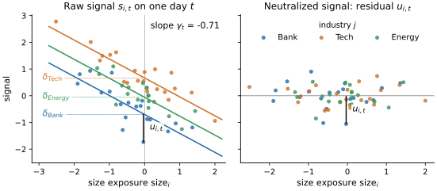

# Lab 04 · 收益从哪来

> 难度 ★★★☆☆ · 预计 3–4 小时 · 前置：lab03（信号还是噪声）

lab03 讲的是怎么判断一个回测在统计上是不是噪声。这个 lab 问的是更根本的问题：
**如果一个信号真的能赚钱，钱是谁给你的？** 答不上来的信号，统计上再显著也值得怀疑；
答得上来，你才知道它什么时候会失效、能放多大的规模、会不会已经被挤满了。

我们用横截面因子（每天在一群股票之间比较、做多一部分、做空一部分）作为载体，
因为这是量化股票投资的主流框架，也是“收益从哪来”这个问题被研究得最透彻的地方。

本 lab 由三部分组成：

1. **讲义**（本文件）
2. **审计**（[`audit.py`](audit.py)）：一份“alpha 显著”的因子研究，找出并修正让结论偏乐观的错误。
3. **思考题**

现成的工具都在 `quantlab.factors` 里。

---

## 1. 因子是什么：把收益拆开

一只股票的收益可以拆成几块：

$$
r_{i,t+1} = \underbrace{\beta_i\, r_{m,t+1}}_{\text{市场}} + \underbrace{\sum_k b_{ik}\, f_{k,t+1}}_{\text{已知风格因子}} + \underbrace{\alpha_{i,t}}_{\text{你想找的}} + \varepsilon_{i,t+1}
$$

| 符号 | 含义 |
| --- | --- |
| $i$ | 股票编号 |
| $t$ | 日期。$t$ 收盘时已知的信息，用来预测 $t$ 到 $t+1$ 的收益 |
| $r_{i,t+1}$ | 股票 $i$ 从 $t$ 收盘到 $t+1$ 收盘的简单收益（日频） |
| $r_{m,t+1}$ | 同一期市场组合的收益（市场因子） |
| $\beta_i$ | 股票 $i$ 对市场的敏感度：市场涨 1%，它平均涨 $\beta_i$% |
| $k$ | 风格因子编号（小盘、价值、动量、低波动、质量……） |
| $f_{k,t+1}$ | 第 $k$ 个因子在这一期的收益。每个因子本身是一个多空组合（例如“做多小盘、做空大盘”）的日收益 |
| $b_{ik}$ | 股票 $i$ 对因子 $k$ 的暴露（载荷），例如“有多小盘” |
| $\alpha_{i,t}$ | 去掉以上所有已知成分之后，$t$ 时刻的信号还能预测的那部分收益。下标是 $t$ 而不是 $t+1$：它必须在 $t$ 时刻就可知 |
| $\varepsilon_{i,t+1}$ | 剩余的、不可预测的特异收益，均值为 0 |

- **市场**：所有股票都跟着大盘涨跌，$\beta_i$ 是敏感度。
- **风格因子**：每个因子 $f_k$ 是一个多空组合的收益，$b_{ik}$ 是股票对它的暴露。
- **alpha**：去掉以上所有已知成分之后，你的信号还能预测的那部分。

CAPM 回归 $r_i - r_f = \alpha + \beta (r_m - r_f) + \varepsilon$ 是只有市场一个因子的特例。
这是一个**时间序列**回归：固定一只股票（或一个组合），每一天是一个观测。$r_f$ 是无风险利率
（与收益同频率，日频回归时用年化利率 / 252），$r_i - r_f$ 和 $r_m - r_f$ 是超额收益，
$\beta$ 是斜率，截距 $\alpha$ 是平均每期（每日）的超额收益中市场解释不了的部分，乘以 252 得到年化 alpha。
$\alpha$ 的 t 值检验的就是“这部分是不是噪声”（lab03）。
加入更多因子（Fama-French 三因子、五因子……）后，很多在 CAPM 下“有 alpha”的策略，alpha 都消失了：
**它们赚的是已知因子的溢价，只是换了个说法。**

这件事的重要性在于：已知因子的溢价很便宜（买一个风格 ETF 就能拿到），而真正的 alpha 稀缺且昂贵。
如果你的“新因子”只是小盘因子的一个变体，它在组合里不提供任何新东西。

## 2. 衡量一个横截面信号

**IC（Information Coefficient）**：每天，计算信号排名和下一期收益排名的相关系数（Spearman），
得到一个 IC 时间序列：

$$
IC_t = \operatorname{corr}\big(\operatorname{rank}(s_{\cdot,t}),\ \operatorname{rank}(r_{\cdot,t+1})\big)
$$

其中 $s_{\cdot,t}$ 是第 $t$ 天所有股票的信号（一个长度为 $N$ 的向量），$r_{\cdot,t+1}$ 是同一批股票下一天的收益，
相关系数在**横截面**上计算（$N$ 只股票是 $N$ 个观测）。注意信号用 $t$、收益用 $t+1$：用同一天的收益算 IC 就是前视。好的因子日度 IC 通常只有 0.02–0.05，看起来小得可怜，
但只要它**稳定**为正，加上广度，就足够赚钱。

**ICIR** = IC 均值 / IC 标准差，衡量稳定性。用日度 IC 算出来的是日频 ICIR，乘以 $\sqrt{252}$ 得到年化值；
$\text{ICIR} \times \sqrt{T}$（$T$ 为天数）就是“平均 IC = 0”的 t 统计量。

**主动管理基本定律**（Grinold, 1989）把这件事说清楚了：

$$
IR \approx IC \times \sqrt{\text{breadth}}
$$

- $IR$（Information Ratio，信息比率）：主动收益的年化均值除以它的年化标准差。对一个多空组合，就是它的年化 Sharpe。
- $IC$：**每一次下注**的平均 IC，即上面的日度 IC 均值。
- breadth：每年**独立**下注的次数。300 只股票、每天调仓，breadth 是 300 × 252；30 只股票，少了 10 倍，
IR 就少了 $\sqrt{10} \approx 3.2$ 倍。**一个很弱的信号，可以通过在足够多的股票上、足够频繁地使用，
变成一个很高 Sharpe 的组合**——前提是它在每个下注上都是独立的，而且成本不吃掉它（第 4 节）。

在合成数据上模拟：同一个日度 IC 约 0.02 的信号，在 300 只股票上做五分组多空，年化 Sharpe 为 4.56；
只用 30 只股票，Sharpe 降到 1.40。两者之比约 3.3，和 $\sqrt{10} \approx 3.2$ 基本吻合。
（不扣成本、股票之间完全独立，所以绝对数字远高于现实，要看的是比值。）

**分组收益**：按信号把股票分成 5 组，看每组的下一期平均收益。好的因子应该**单调**：
第 5 组 > 第 4 组 > … > 第 1 组。只有两端好、中间乱，往往说明收益集中在少数极端股票上（可能是小盘、
低流动性、甚至是数据错误）。

**多空组合**：做多最高组、做空最低组。它对冲掉了大部分市场暴露，但**不一定对冲掉其他因子暴露**。

## 3. 暴露与中性化：剥掉已知的那部分

假设你的信号是“过去一年的盈利增速”。盈利增速高的公司往往是小公司（基数小）。于是你的多空组合
天然做多小盘、做空大盘。在小盘跑赢的年份，你会以为自己发现了 alpha。

**中性化**就是每天在横截面上做回归：

$$
s_{i,t} = \gamma_t\, \text{size}_i + \sum_{j=1}^{J} \delta_{j,t}\, \mathbb{1}[\text{行业}_i = j] + u_{i,t}
$$

每个符号的含义：

| 符号 | 含义 |
| --- | --- |
| $i$ | 股票编号。回归是**横截面**的：固定一天 $t$，把当天的 $N$ 只股票当作 $N$ 个观测 |
| $t$ | 日期。每一天单独做一次回归，所以下面带 $t$ 下标的系数每天都不同 |
| $s_{i,t}$ | 原始信号：股票 $i$ 在第 $t$ 天收盘时的分数（例如盈利增速），被解释变量 |
| $\text{size}_i$ | 股票 $i$ 的规模暴露，通常是市值取对数后再做横截面标准化。这里假设它不随时间变；实际中每天更新，写作 $\text{size}_{i,t}$ |
| $\gamma_t$ | 第 $t$ 天信号对规模的载荷：当天信号里有多少可以由“公司大小”解释。$\gamma_t < 0$ 表示小公司的信号普遍更高，也就是信号里混进了小盘暴露 |
| $J$ | 行业的个数 |
| $\mathbb{1}[\text{行业}_i = j]$ | 行业哑变量（指示函数）：股票 $i$ 属于行业 $j$ 时取 1，否则取 0 |
| $\delta_{j,t}$ | 第 $t$ 天行业 $j$ 的平均信号水平（在控制规模之后）。它吸收掉“整个行业的信号都偏高”这一部分 |
| $u_{i,t}$ | 残差：信号里**既不能用规模、也不能用行业解释**的部分，也就是中性化后的新信号 |



*图：同一天 $t$、同一批 60 只股票（模拟数据）。左图是原始信号对规模的散点，每种颜色是一个行业。
三条拟合线**互相平行**，共同的斜率就是 $\gamma_t$（这里为 −0.71：规模越小，信号越高，即信号里混进了小盘暴露）；
每条线在 $\text{size}=0$ 处的高度就是该行业的 $\delta_{j,t}$；黑色竖线是某一只股票到它所在行业那条线的距离，
即残差 $u_{i,t}$。右图把每只股票换成它的残差：和规模不再有任何关系（相关系数为 0），每个行业的残差均值也都是 0。
中性化做的事，就是把左图里“线”能解释的部分拿掉，只留下“点到线的距离”。*

公式里没有单独的截距项。每只股票恰好属于一个行业，所以 $J$ 个行业哑变量加起来是一列全为 1 的常数，
已经起到了截距的作用。如果再加一个截距 $c_t$，它就和这列常数完全重复，回归矩阵不可逆，
这就是“哑变量陷阱”。另一种等价写法是保留截距、只放 $J-1$ 个行业哑变量，得到的残差完全相同。

用残差 $u_{i,t}$ 作为新的信号。它和 size、行业在当天的横截面上正交（与每个解释变量的样本协方差为 0），
所以用它构建的组合不会因为“恰好是小盘”或“恰好是某个行业”而赚钱。

**和 CAPM 回归的区别**：§1 的 CAPM 回归是**时间序列**回归，一只股票、很多天，估计这只股票的 $\beta$；
这里的中性化是**横截面**回归，一天、很多只股票，估计当天信号和各个暴露之间的关系。
同样是“回归取残差”，两者的观测单位完全不同。

检查一个因子是不是“真 alpha”的两种做法：

1. **构建时中性化**：对已知暴露做回归取残差，再构建组合。
2. **事后归因**：把多空组合收益对已知因子收益做时间序列回归，看截距（alpha）是否显著。

两者都需要一个“已知因子”清单，这个清单本身就是判断：你认为哪些收益来源是“已知的、便宜的”。

模拟一个**本身没有任何 alpha**、只是混入了大量小盘暴露的信号（样本期内小盘因子年化溢价 12%）：

| 检查方式 | 结果 |
| --- | --- |
| 五分组多空 Sharpe | 2.45，看起来是个好因子 |
| 只对市场回归的 alpha t 值 | 7.7 |
| 对市场 + 小盘回归的 alpha t 值 | -0.8 |
| 对小盘暴露中性化后的多空 Sharpe | -0.08 |

只控制市场时，它的 alpha“极其显著”；把已知的小盘因子放进来，alpha 就完全消失了。

## 4. 换手与成本

信号每天变化得越快，组合换手越高。单边成本 10bp 时，日均换手 100% 的组合每年要付
$252 \times 1.0 \times 10\text{bp} \approx 25\%$ 的成本。很多在毛收益上 Sharpe 很高的短周期信号，
扣完成本是负的。这里日换手定义为 $\sum_i |w_{i,t} - w_{i,t-1}|$（$w_{i,t}$ 是股票 $i$ 在第 $t$ 天的权重，
买和卖都计入），三个因子依次是：一年 252 个交易日、日换手 1.0（100%）、每单位换手的成本 10bp。

决定换手的是**信号的自相关**：基本面信号（估值、盈利质量）变化缓慢，换手低；
价格类短周期信号（短期反转、日内动量）变化快，换手高。评估一个信号时，
**IC 衰减曲线**（用 t 日信号预测 t+k 日收益的 IC 随 k 怎么下降）和换手要一起看：
预测能力持续得越久，你越可以慢慢调仓、少付成本。

模拟三个 IC 相同（约 0.02）、只是信号每天变化速度不同的信号，单边费率 10bp：

| 信号日自相关 | 日均换手 | 毛 Sharpe | 净 Sharpe |
| --- | --- | --- | --- |
| 0.00 | 320% | 4.26 | -9.14 |
| 0.95 | 72% | 4.53 | 1.49 |
| 0.99 | 32% | 4.73 | 3.37 |

扣成本前三者几乎一样；扣成本后，变化最快的那个从 4.26 变成了 -9.14。

## 5. 收益从哪来

这是这个 lab 最重要的一节。一个能持续赚钱的信号，背后几乎总是下面四种机制之一。
**判断一个信号属于哪一种，比算出它的 t 值更能告诉你它的未来。**

### 5.1 风险溢价：你替别人承担了他们不愿承担的风险

价值股（便宜的股票）往往是处境困难的公司，在经济衰退时跌得最惨；小盘股在流动性危机里最难卖出。
投资者要求额外的回报来补偿这些“在最坏的时候亏钱”的风险。

- **对手方**：愿意为“避开坏时期”付费的投资者（相当于他们在买保险，你在卖保险）。
- **为什么不会被套利掉**：因为它不是免费的午餐，承担它的人真的会在坏时期亏大钱。
- **特征**：长期为正，但会有很长、很深的回撤，而且回撤集中在市场整体糟糕的时候。
- **失效方式**：不会“消失”，但你可能等不到它回来（基金被赎回、职业生涯结束）。

### 5.2 行为偏差：有人系统性地犯错

动量（过去涨得多的继续涨）的一个解释是投资者对新信息反应不足；
彩票型股票（高波动、高偏度）收益偏低，是因为散户偏爱它们、愿意付高价。

- **对手方**：犯错的投资者。
- **为什么不会被套利掉**：**套利有限**（Shleifer & Vishny, 1997）——纠正错误需要资本、需要承担风险
  （错误可能先变得更大）、需要做空（贵、有时做不到）。
- **失效方式**：投资者变得更理性，或者套利资本变多。这种收益在被发现、被发表之后衰减最明显。

### 5.3 流动性提供：别人急着交易，你收一点手续费

短期反转（昨天跌得多的今天反弹）很大程度上是流动性的补偿：有人急着卖（被迫平仓、赎回），
价格被临时压低，接盘的人在价格回归时赚钱。

- **对手方**：急需成交的人，他们为即时性付费。
- **特征**：信号变化快、换手高、容量小，在市场波动大时收益更高（别人更急）。
- **失效方式**：做市竞争加剧，价差被压缩。

### 5.4 结构性约束：有人被规则逼着这样交易

很多机构不能加杠杆，想要高收益就只能买高 beta 股票，把它们的价格推高——于是低 beta 股票的风险调整后收益更高
（Frazzini & Pedersen, 2014）。指数调整日，被动基金必须按规则买卖成分股。

- **对手方**：受约束的投资者，他们知道自己在“亏钱”，但别无选择。
- **为什么不会被套利掉**：约束本身是制度性的，只要制度不变，它就在。
- **失效方式**：规则改变。

### 5.5 拥挤与衰减

即使一个信号背后有真实的机制，**知道它的人越多，能分到的就越少**。McLean & Pontiff (2016) 统计了 97 个
学术发表的因子：发表之后，它们的收益平均下降了大约三分之一（其中一部分是原本就过拟合的部分，一部分是被套利掉的部分）。

模拟一个前 10 年 IC 为 0.04、发表并被广泛使用后 IC 降到 0.015 的因子：全部 20 年的多空 Sharpe 为 6.38，
前 10 年为 9.22，后 10 年只有 3.75。在第 10 年读到论文、开始交易的人，拿到的是 3.75；
而如果他用全样本回测来决定规模，看到的是 6.38。

拥挤还有一个更危险的后果：大家持有相同的头寸，一旦有人被迫平仓，所有人一起亏。
2007 年 8 月的“量化地震”中，多个量化基金的多空组合在几天内同时大幅回撤，起因是一家大型机构去杠杆，
抛售了和所有人都相似的持仓。

**对一个信号的四个追问**：

1. 它属于哪种机制？对手方是谁？
2. 对手方为什么会持续存在？
3. 有多少人知道它？它的容量有多大？
4. 它在什么样的市场环境下会大幅亏损？那时你还拿得住吗？

## 6. 局限

- **因子动物园**：学术界已经发表了几百个“显著”的因子，绝大部分是多重检验的产物。
  Harvey, Liu & Zhu (2016) 建议新因子的 t 值门槛应提高到 3 左右，而不是 2。
  模拟 100 个**完全随机**、缓慢变化（像真实的基本面因子）的信号，放在没有任何 alpha 的股票池上：
  3 个的 IC t 值超过 2，1 个超过 3；t 值最大的那个 |t| = 3.10，五分组多空 Sharpe 1.42——
  足够写成一篇论文。
- **幸存者偏差**：只用“现在还在”的股票做回测，会漏掉所有退市的公司，而它们退市前往往有巨大的亏损。
  回测宇宙必须是**当时**存在的所有股票。
- **点时数据**：财报数据在报告期结束后要几周到几个月才公布，而且会被修订。用“报告期”而不是“公布日”
  对齐数据，就是在用未来信息。
- **已知因子清单的选择**：控制了哪些因子，决定了什么被称为 alpha。今天的 alpha 可能是明天的因子。

---

## 审计

打开 [`audit.py`](audit.py)：一份结论为“复合因子 alpha 显著，建议纳入模型”的研究代码。

1. 先不要跑测试。读代码，在文件开头的「审计记录」里写下发现的问题和理由。
2. 逐个修正。
3. 运行 `make test LAB=04`，看看漏了什么。

测试检查的是审查任何因子研究都值得做的几件事：信息是否在收益之前可得？分组是否用到了未来？
回测宇宙是否包含了当时所有的股票（包括后来退市的）？成本是否扣除？“alpha”是否只是已知溢价？

## 思考题

1. 修正之后，在“只有小盘暴露”的数据上，多空组合的毛 Sharpe 仍然可以很高。如果你的老板只看这个数字，
   你会怎么向他解释“这不是 alpha”？如果他说“管它是不是 alpha，能赚钱就行”，你怎么回答？
   （提示：想想成本、费率、以及客户为什么付钱给你。）
2. 选一个你听说过的 A 股选股因子（比如小市值、低换手、反转），用第 5 节的四个追问分析它。
   2017 年之后 A 股小市值因子大幅回撤，用你的分析解释可能的原因。
3. 第 4 节的模拟里，自相关为 0 的信号毛 Sharpe 很高，净 Sharpe 是负的。有没有办法在不改变信号的情况下
   降低它的换手？代价是什么？
4. 审计题里的复合因子把“基本面信号”和“5 日动量”等权相加。从换手的角度看，这样组合合理吗？
   你会怎么组合两个变化速度完全不同的信号？

## 拓展：真实数据

```python
from quantlab import factors, realdata

px = {s: realdata.a_share_daily(s)["close"] for s in ["600519", "000858", "601318", "600036"]}
```

真实的横截面研究需要几百只股票、点时财务数据和退市股票的完整历史，这些免费数据源很难凑齐——
这本身就是一课：**数据的质量决定了你能相信多少结论**。可以先从“沪深300 成分股的短期反转”这种
只需要价格的信号开始，注意成分股名单本身就有幸存者偏差（今天的成分股是“活下来并且变大了的”）。

## 参考文献

- Grinold, R. (1989). *The Fundamental Law of Active Management.* Journal of Portfolio Management.
- Fama, E. & French, K. (1993). *Common Risk Factors in the Returns on Stocks and Bonds.* Journal of Financial Economics.
- Shleifer, A. & Vishny, R. (1997). *The Limits of Arbitrage.* Journal of Finance.
- Khandani, A. & Lo, A. (2007). *What Happened to the Quants in August 2007?*
- Frazzini, A. & Pedersen, L. H. (2014). *Betting Against Beta.* Journal of Financial Economics.
- McLean, R. D. & Pontiff, J. (2016). *Does Academic Research Destroy Stock Return Predictability?* Journal of Finance.
- Harvey, C., Liu, Y. & Zhu, H. (2016). *… and the Cross-Section of Expected Returns.* Review of Financial Studies.
