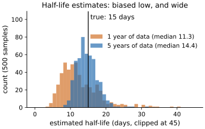
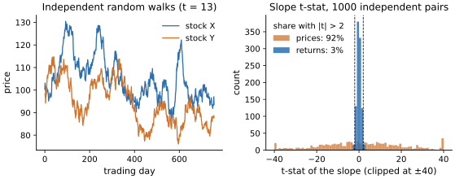
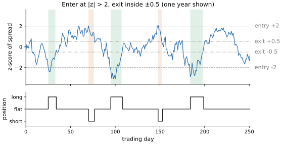

# Lab 06 · 均值回归与配对交易

> 难度 ★★★☆☆ · 预计 3–4 小时 · 前置：lab03（信号还是噪声）、lab04（收益从哪来）

配对交易是量化里最“直观”的策略：两只走势相似的股票，价差拉开了就做空贵的、做多便宜的，
等价差回归时平仓。它的数学工具（平稳性、协整、OU 过程）很优雅，回测曲线往往很平滑。

也正因为如此，它是**统计显著性最容易被误读**的地方之一：两条不相关的随机游走会“看起来”高度相关；
在一百只股票里两两检验，总能找到几对“协整”的；价差回归的历史越平稳，那次不再回归的打击就越致命。

这个 lab 要建立的判断：一对价格的“关系”什么时候是真的？你的检验在多大程度上被搜索过程污染了？
你赚的是什么钱，又在承担什么风险？

本 lab 由三部分组成：讲义（本文件）、[审计](audit.py)、思考题。
现成的工具在 `quantlab.pairs` 里。

---

## 1. 平稳与均值回复

一个序列**平稳**，粗略地说，就是它的统计性质不随时间变化：有固定的均值，偏离之后会被拉回来。
股票价格本身不平稳（近似随机游走），偏离之后没有任何力量把它拉回去。

最简单的均值回复模型是 AR(1)：

$$
x_t = c + \phi\, x_{t-1} + \varepsilon_t,\qquad |\phi| < 1
$$

| 符号 | 含义 |
| --- | --- |
| $t$ | 时间，这里以**交易日**为单位，所以下面的半衰期单位也是天 |
| $x_t$ | 第 $t$ 天的序列值，例如两只股票的对数价差 |
| $c$ | 常数项 |
| $\phi$ | 持续性（自回归系数）：今天的偏离有多大比例会留到明天。$\phi$ 越接近 1，回复越慢；$\phi = 1$ 是随机游走，不回复 |
| $\varepsilon_t$ | 第 $t$ 天的随机冲击，均值为 0、方差 $\sigma_\varepsilon^2$，各天独立 |

它的长期均值是 $c/(1-\phi)$，偏离以 $\phi$ 的速度衰减。**半衰期**是偏离缩小一半所需的时间：

$$
h = -\frac{\ln 2}{\ln \phi}
$$

推导：偏离均值的部分每天乘以 $\phi$，$h$ 天后剩下 $\phi^h$，令 $\phi^h = 1/2$ 即得。
$\phi = 0.955$ 对应 15 天，$\phi = 0.87$ 对应 5 天。它是连续时间 **Ornstein-Uhlenbeck 过程**
$dX = \kappa(\theta - X)dt + \sigma dW$ 的离散版本：

- $X$：连续时间下的序列值；$dX$ 是它在极短时间 $dt$ 内的变化。
- $\theta$：长期均值，等于 $c/(1-\phi)$。
- $\kappa$：回复速度，单位是“每天”；偏离以 $e^{-\kappa t}$ 衰减。时间步长为 1 天时 $\kappa = -\ln\phi$，
  半衰期也可以写成 $h = \ln 2 / \kappa$。
- $\sigma$：冲击的强度（波动率）；$dW$ 是布朗运动的增量，均值 0、方差 $dt$。

半衰期决定了策略的节奏：持仓多久、z-score 用多长的窗口、交易有多频繁。

**估计的陷阱**：$\phi$ 的 OLS 估计在小样本下是**向下偏**的（Kendall 偏差，约 $-(1+3\phi)/T$，$T$ 是用来估计的观测天数），
所以半衰期会被系统性地**低估**——数据越短，你越会以为它回归得比实际更快。
而且 $\phi$ 接近 1 时，“回归很慢”和“根本不回归”在有限样本里很难区分。

在合成数据上模拟一个真实半衰期为 15 天的价差，重复 500 次：用 1 年数据估计，半衰期的中位数是 11.3 天，
90% 区间 [6.1, 23.1]；用 5 年数据，中位数 14.4 天，90% 区间 [10.5, 19.5]。1 年数据不但偏低，
而且区间宽得几乎没法用来设定持仓周期。



*图：真实半衰期为 15 天（黑线）的价差，各模拟 500 次，用 OLS 拟合 AR(1) 后换算出的半衰期。橙色是只用 1 年数据：
中位数 11.3 天，整体偏左（Kendall 偏差让 $\hat\phi$ 偏小、半衰期偏短），而且拖着一条长长的右尾。蓝色是 5 年数据：
中位数 14.4 天，分布收窄到 [10.5, 19.5]。同一个真实过程，1 年数据给出的答案可以是 6 天也可以是 23 天。*

## 2. 协整：两条随机游走之间的平稳关系

两只股票的价格各自是随机游走，但某个线性组合是平稳的：

$$
\log P^Y_t - \beta \log P^X_t - \alpha = s_t \quad\text{平稳}
$$

- $P^Y_t$、$P^X_t$：两只股票 Y、X 在第 $t$ 天的价格（取对数后各自近似随机游走）。
- $\beta$：对冲比例。因为用的是对数价格，它是**金额**之比：每做多 1 元 Y，做空 $\beta$ 元 X。
- $\alpha$：常数，吸收两只股票价格水平的差异，让价差的均值为 0。
- $s_t$：价差。“平稳”指它有固定的均值和方差，偏离之后会被拉回来（可以用上面的 AR(1) 描述）。

这时称它们**协整**，$\beta$ 是对冲比例，$s_t$ 是价差。

**伪回归**（Granger & Newbold, 1974）：如果直接把一条随机游走对另一条**独立的**随机游走做回归，
斜率的 t 值会“显著”的概率远不止 5%，R² 也常常不小。原因是两个序列都有随机趋势，
OLS 会把两个趋势“对上”，而普通 t 检验假设残差平稳——这里它不平稳。
**两个价格序列的相关系数或回归 R² 本身几乎没有信息量。**

模拟两只**完全独立**的随机游走股票，各 3 年日数据，把一只的对数价格对另一只回归，重复 1000 次：
斜率 |t| > 2 的比例是 **92%**（正常应约 5%），R² 的中位数 0.18。改成对**日收益**回归，
|t| > 2 的比例回到 3%——收益是平稳的，问题出在对非平稳的价格直接回归。



*图：左图是一对**完全独立**的随机游走股票（3 年日数据）。它们的走势毫无关系，但把 Y 的对数价格对 X 回归，
斜率的 t 值是 13、R² 为 0.18——这是 1000 对模拟里 |t| 的中位数，也就是说它只是一个“典型”的例子。
右图是 1000 对独立股票的斜率 t 值：对价格回归（橙色）几乎均匀地铺满 ±40，92% 落在虚线 ±2 之外；
对日收益回归（蓝色）集中在 0 附近，只有 3% 超过 ±2，和 t 检验本该有的 5% 一致。*

**Engle-Granger 两步法**：

1. OLS 回归 $\log P^Y$ 对 $\log P^X$，得到 $\hat\beta, \hat\alpha$；
2. 对残差 $\hat s_t$ 做单位根检验（ADF），拒绝“有单位根”就认为协整。

关键细节：第 2 步**不能用普通 ADF 的临界值**。因为 $\hat\beta$ 是 OLS 挑出来的——
OLS 恰好找了让残差方差最小、看起来最平稳的那个组合，所以残差天然“偏平稳”。
用普通临界值，两条独立的随机游走大约有 15–20% 的概率被判为协整。
Engle-Granger 检验（`statsmodels.tsa.stattools.coint`）用的是专门为这种情况计算的、更严格的临界值。

## 3. 搜索：在 N 只股票里找配对

N 只股票有 $N(N-1)/2$ 对。100 只股票是 4950 对，即使每次检验都完美校准，
在 5% 的水平下也会有约 250 对“协整”——全部是假阳性。这是 lab03 多重检验在配对交易里的版本。

小一点的模拟：20 只彼此独立的随机游走股票，两两做 Engle-Granger 检验（190 对）。这次有 3 对 p < 0.05
（期望约 10 对），最小的 p 值是 0.0126——单独拿出来看
已经“相当显著”，但 Bonferroni 门槛是 0.05/190 = 0.00026，它离得很远。

应对：

- **Bonferroni**：门槛改为 $0.05 / \text{检验次数}$。保守，但简单。
- **先验筛选**：只检验有经济理由相关的对（同行业、同一现金流、同一产业链），把检验次数从几千降到几十。
  这比任何统计校正都有效。
- **样本外确认**：在训练段选出的对，必须在之后的数据上仍然表现出均值回复。

## 4. 交易规则与收益形态

最常见的规则：价差的 z-score（用滚动均值和标准差标准化）超过 +2 时做空价差，低于 -2 时做多，
回到 ±0.5 以内平仓。z-score 的定义是

$$
z_t = \frac{s_t - m_t}{\sigma_t}
$$

其中 $s_t$ 是第 $t$ 天的价差，$m_t$ 和 $\sigma_t$ 是价差在过去 $L$ 天（含第 $t$ 天，$L$ 为窗口长度，例如 60）
的均值和标准差。$z_t = 2$ 表示价差比近期均值高出 2 个标准差。$z_t$ 在第 $t$ 天收盘时算出，
据此建立的仓位只能吃到 $t+1$ 及以后的收益。“做空价差”指做空 1 元 Y、做多 $\beta$ 元 X。



*图：一对半衰期 10 天的协整股票，截取其中一年。上图是价差的 60 日滚动 z-score，虚线是进场阈值 ±2，点线是出场阈值 ±0.5；
绿色阴影是做多价差的区间（z 跌破 −2 进场，回到 −0.5 以上平仓），橙色阴影是做空价差的区间。下图是对应的仓位。
这一年开了 5 笔交易，每笔都在 z-score 越过 ±2 之后建立、在回到 ±0.5 以内时结束：策略大部分时间空仓，只在价差偏离足够大时下注。*

两个需要注意的点：

1. **滚动窗口**：z-score 的均值和标准差只能用过去的数据。用全样本的均值标准化，
   等于告诉策略“价差最终会回到哪里”——这正是它本不该知道的。
2. **收益形态**：配对交易大多数交易小赚（价差回归），少数交易大亏（价差继续发散，止损或被迫平仓）。
   胜率很高、收益曲线平滑，但**左尾很厚**。它在经济上更像卖出期权，而不是低风险套利。

   模拟一对健康的协整股票（半衰期 10 天），z-score ±2 进场、±0.5 出场，交易 10 年：共 98 笔交易，
   胜率 90%，平均盈利 1.23%、平均亏损 -0.98%，每笔交易盈亏的偏度为 -0.57。而这还是一对关系**永远不会断裂**的股票；
   一旦价差有很小的概率永久性地不再回归，左尾会厚得多——这就是配对交易常被称为“在压路机前捡硬币”的原因。

## 5. 收益从哪来，风险在哪里

用 lab04 的框架看配对交易：

- **流动性提供**：价差拉开往往是因为有人急着买或卖其中一只（大单冲击、指数调整、被迫平仓）。
  你接住了这个流动性需求，在价格恢复时获得补偿。这种来源的配对，半衰期短、容量小。
- **同一现金流的不同报价**：A/H 股、ETF 与成分股、期货与现货、可转债与正股。这些关系有**机制**保证
  （套利、转换、交割），协整是真的，但价差通常很小，竞争激烈。
- **“相似”的公司**：同行业的两家公司。这里没有任何机制保证它们的价格会保持关系——
  一次并购、一次财务造假、一次业务转型，关系就永久改变了。大部分“统计配对”属于这一类。

**风险**：

- **关系断裂**：协整关系不是永恒的。断裂发生时，你的头寸恰好站在错误的一边（越偏离越加仓）。
- **拥挤与去杠杆**：配对交易和统计套利是 2007 年 8 月“量化地震”的中心（lab04 §5.5）。
  所有人持有相似的头寸，一旦有人被迫平仓，价差会**朝着所有人亏钱的方向**同时扩大。
- **LTCM**（1998）：长期资本管理公司的核心交易之一是相对价值套利。价差在俄罗斯违约后大幅扩大，
  杠杆让“最终会回归”的头寸在回归之前就把公司打垮了。**市场保持非理性的时间，可以比你保持偿付能力的时间更长。**

## 6. 自适应的权衡

对冲比例会随时间变化，所以一个自然的想法是在线更新它（滚动回归、Kalman 滤波）。
但这里有一个根本的权衡：

- 适应得**慢**：对真实的关系变化反应迟钝，断裂后长期持有错误的对冲。
- 适应得**快**：估计出来的“关系”会去追逐价差本身，把你要交易的均值回复信号吸收掉——
  价差还没回归，模型已经把“新的均衡”挪到了偏离的位置。

这和“用多长的窗口估计参数”是同一个问题，没有免费的答案。

在合成数据上比较两种对冲方式（价差半衰期 10 天，后 3 年交易，各 20 次模拟取平均）：
(a) 用前 3 年估计的**固定**对冲比例；(b) 用 Kalman 滤波**在线更新**对冲比例和截距。

| 情形 | 固定对冲 Sharpe | Kalman Sharpe |
| --- | --- | --- |
| 对冲比例始终为 1.0 | 1.60 | 0.38 |
| 第 3 年末并购，对冲比例变成 1.5 | 0.79 | 0.50 |

断裂让固定对冲的 Sharpe 减半；但 Kalman 在两种情形下都**更差**。它的截距跟得太快，
把要交易的价差偏离本身当成了“新的均衡”吸收掉了。自适应不是免费的保险。

## 7. 局限

- **检验的功效低**：半衰期较长的真实协整关系，在几年的数据里常常检验不出来（第 1 节的半衰期模拟、思考题 1）。
- **线性关系的假设**：协整假设的是对数价格的线性组合平稳，现实中的关系可能是非线性的、随状态变化的。
- **做空约束**：A 股融券困难且成本高，很多配对交易在现实中根本无法执行。
- **成本**：每次进出场是两只股票、四笔交易。短半衰期的配对换手高，成本占比大。

---

## 审计

打开 [`audit.py`](audit.py)：一份结论为“找到一对高度协整的股票，样本外表现优异”的研究代码。

1. 先不要跑测试。读代码，在文件开头的「审计记录」里写下发现的问题和理由。
2. 逐个修正。
3. 运行 `make test LAB=06`，看看漏了什么。

测试检查的是审查任何配对研究都值得做的几件事：改动未来，过去的收益会不会变？
协整检验在零假设下是否校准？搜索了上百对之后，“显著”的门槛有没有相应提高？成本是否扣除？
真正协整的那一对，修正之后还能不能被找到？

## 思考题

1. 审计题里，真正协整的那一对半衰期是 5 天。把它改成 15 天（`pairs.simulate_universe(cointegrated_pair=True, half_life=15)`），
   修正后的流程还能找到它吗？如果找不到，你会怎么改进流程——而不是放宽显著性门槛？
2. 你的 AI 助手在沪深300成分股里两两检验协整，报告“找到 37 对 p < 0.01 的配对”。
   你的第一个问题是什么？在什么情况下，37 对是一个值得进一步研究的结果？
3. 茅台和五粮液、招商银行和平安银行、中国平安的 A 股和 H 股：用第 5 节的分类分析这三对，
   哪一对的协整关系最可信？哪一对最可能断裂？断裂的方式会是什么？
4. 第 4 节模拟的配对交易胜率很高、偏度为负。如果用这个策略加 5 倍杠杆，你最担心的是什么？
   设计一个止损规则，并说说它的代价（提示：止损会在价差最偏离、也就是预期收益最高的时候平仓）。

## 拓展：真实数据

```python
import numpy as np
import pandas as pd

from quantlab import pairs, realdata

a = realdata.a_share_daily("600519")["close"]  # 贵州茅台
b = realdata.a_share_daily("000858")["close"]  # 五粮液
df = np.log(pd.concat([a, b], axis=1, join="inner").dropna())
pairs.engle_granger(df.iloc[:, 0], df.iloc[:, 1])
```

分别用 2015–2019 和 2020–2024 两段数据检验。对冲比例和 p 值稳定吗？

## 参考文献

- Granger, C. & Newbold, P. (1974). *Spurious Regressions in Econometrics.* Journal of Econometrics.
- Engle, R. & Granger, C. (1987). *Co-integration and Error Correction.* Econometrica.
- Gatev, E., Goetzmann, W. & Rouwenhorst, K. G. (2006). *Pairs Trading: Performance of a Relative-Value Arbitrage Rule.* Review of Financial Studies.
- Lowenstein, R. (2000). *When Genius Failed: The Rise and Fall of Long-Term Capital Management.*
- Khandani, A. & Lo, A. (2007). *What Happened to the Quants in August 2007?*
