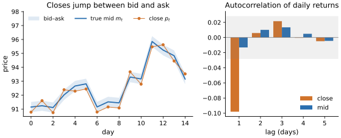

# Lab 08 · 成交假设：回测里最隐蔽的 alpha

> 难度 ★★★★☆ · 预计 3 小时 · 前置：lab02（向量化回测）、lab03（信号还是噪声）

每个回测都隐含着一组**成交假设**：在什么时间、以什么价格、成交了多少。
它们很少被写在报告里，却常常决定了结论。一个在收盘价上 Sharpe 1.0 的策略，
换成“下一根 bar 开盘、付半个价差、受成交量约束”之后，可能变成 Sharpe -1。

这个 lab 不再让你写回测引擎——`quantlab.engine` 是现成的，它把每根 bar 内的事件顺序
固定为“开盘撮合之前的订单 → 收盘记录净值 → 策略看到收盘价并下单”，在结构上杜绝了前视。
你要学的是：**看一份回测时，怎样识别它的成交假设，并判断这些假设是否站得住。**

结构：讲义 → [审计](audit.py) → 思考题。

---

## 1. 你能以收盘价成交吗？

“t 日收盘价产生信号，以 t 日收盘价成交”是最常见、也最难察觉的乐观假设。

- **时间上**：收盘价在收盘之后才知道。用它算信号再以它成交，就是前视——哪怕只有几秒。
  收盘集合竞价可以按收盘价成交，但下单必须在竞价结束**之前**，那时你还不知道收盘价。
- **价格上**：收盘价本身不是一个“价格”，而是最后一笔成交，它落在买价或卖价上。
  随机地落在 bid 或 ask，会让收盘价序列产生**虚假的负自相关**（Roll, 1984）：

$$
\operatorname{Cov}(\Delta p_t, \Delta p_{t-1}) = -\frac{s^2}{4}
$$

  这是 Roll 模型的结论。它假设观测到的成交价 $p_t = m_t + \tfrac{s}{2}\,q_t$：

  | 符号 | 含义 |
  | --- | --- |
  | $t$ | 交易日（这里每天取一个价格，即收盘价） |
  | $p_t$ | 观测到的成交价（收盘价）；用对数价格时，$\Delta p_t$ 就是日对数收益 |
  | $m_t$ | 真实的中间价（mid），假设是随机游走，$\Delta m_t$ 与过去无关 |
  | $q_t$ | 这笔成交落在哪一边：落在卖价（ask）取 $+1$，落在买价（bid）取 $-1$，各一半概率、每天独立 |
  | $s$ | 买卖价差。$p$ 是价格时 $s$ 是价格单位；$p$ 是对数价格时 $s$ 是相对价差（如 80bp = 0.008） |
  | $\Delta p_t$ | $p_t - p_{t-1}$，相邻两天成交价的变化 |

  $\Delta p_t = \Delta m_t + \tfrac{s}{2}(q_t - q_{t-1})$，相邻两天的变化共享同一个 $q_{t-1}$（一个带正号、
  一个带负号），协方差正是 $-\tfrac{s^2}{4}\operatorname{Var}(q_{t-1}) = -\tfrac{s^2}{4}$。
  这个负自相关完全来自 $q$，与真实价格 $m$ 无关。

  于是“今天跌了，明天就买”在收盘价上看起来能赚钱：
  跌出来的收盘价常常落在 bid 上，第二天的收盘价随机落在 bid 或 ask，平均而言“反弹”了半个价差。
  但你买入时付的是 ask，这笔钱根本赚不到。**流动性越差（价差越大）的股票，这个幻觉越强**——
  而短线反转策略恰恰最喜欢在流动性差的股票上回测出好结果。

在合成数据上模拟可得（`quantlab.engine.bounce_ohlcv`：真实 mid 价格是纯随机游走，
成交价随机落在买价或卖价上，价差 80bp，5000 天）：

| 度量 | 收盘价 | 真实 mid |
| --- | --- | --- |
| 日收益一阶自相关 | -0.110 | +0.008 |
| “今天跌超 1.5% 就持有到明天收盘”的 Sharpe | 0.88 | -0.30 |

mid 上没有任何可预测性，收盘价上却凭空出现了 Sharpe 0.88 的“反转 alpha”。
同一个信号，如果老老实实地改成**次日开盘买入、次日收盘卖出、两边各付半个价差**，Sharpe 是 **-2.81**。

*图：同样的模拟（价差 80bp，换了一组随机种子）。左图截取 15 天：蓝线是真实中间价 $m_t$，浅蓝带是买价到卖价的区间，
橙色点是观测到的收盘价 $p_t$——它每天随机落在带子的上沿或下沿，于是今天落在下沿、明天落在上沿时，
收盘价看起来“跌了又涨回来”。右图是 5000 天日收益的自相关：真实 mid 在各个滞后上都落在灰色的 ±2 倍标准误带内（滞后 1 为 −0.013），
收盘价在滞后 1 上是 −0.098，与 Roll 模型预测的 $-\tfrac{s^2}{4}/\mathrm{Var}(\Delta p)\approx -0.087$ 相当，其余滞后都接近 0。
负自相关只出现在相邻两天之间，正是 $q_{t-1}$ 被相邻两次变化共用的结果。*

## 2. 限价单与逆向选择

限价单不付价差，看起来是更便宜的成交方式。回测里最常见的假设是“盘中价格**触及**限价就成交”。
这有两个问题：

- **队列**：价格碰到你的限价，说明在那个价位有成交，但那个价位上排在你前面的订单可能还有很多。
  只碰了一下的价格，你多半排不到。保守的假设是价格**穿过**限价（至少一个 tick）才算成交。
- **逆向选择**：你的买单能成交的情况，是价格跌到你的价位、并且有人愿意卖给你。
  这在什么时候最容易发生？在价格**继续下跌**的时候——卖方掌握的信息往往比你多。
  价格碰了一下就反弹的“好成交”，你恰恰拿不到。所以限价单的条件期望收益，
  低于“按限价成交、每次都成交”的天真估计。

在合成数据上模拟可得：每天在前一日收盘价下方 1% 挂买入限价单，成交后持有到当天收盘：

| 成交假设 | 成交率 | 每笔平均收益 |
| --- | --- | --- |
| 最低价**触及**限价即成交 | 44.3% | -21.6 bp |
| 最低价**穿过**限价 0.2% 才成交 | 38.2% | -39.9 bp |

“穿过”的成交是“触及”的子集，被去掉的那些恰恰是只碰了一下就反弹的好成交。
保守假设下的成交更少，而且每一笔都更差——这就是逆向选择。

做市商的全部生意就是在管理这个问题：赚价差，同时承受逆向选择的亏损。

## 3. 滑点、冲击与容量

一笔交易的成本大致由三部分组成：

1. **佣金和税费**：线性，确定。注意最低佣金对小单的影响。
2. **半个价差**：市价单的固定成本，流动性差的股票可达几十个 bp。
3. **市场冲击**：你的交易本身推动价格。经验上最常用的是**平方根模型**：

$$
\text{冲击} \approx k\,\sigma_{\text{daily}}\sqrt{\frac{Q}{V}}
$$

   | 符号 | 含义 |
   | --- | --- |
   | 冲击 | 成交均价相对决策时参考价（如 arrival 价格）的不利偏离，以价格的**比例**表示（0.001 = 10bp），是每单位交易额的成本 |
   | $k$ | 经验系数，无量纲，约 0.5–1，需要用自己的成交记录校准 |
   | $\sigma_{\text{daily}}$ | 标的的**日**收益波动率（不是年化），如 2% |
   | $Q$ | 这一天你要交易的数量（股数或金额） |
   | $V$ | 标的当天的成交量，与 $Q$ 同一单位（股数对股数、金额对金额）；$Q/V$ 即参与率 |

   每单位成本随 $\sqrt{Q/V}$ 增长，总成本（冲击 × 交易额）就随 $Q^{3/2}$ 增长。冲击随规模的平方根增长，
   所以**成本占收益的比例随资金规模上升**。每个策略都有一个**容量**：超过它，扣费后的收益就消失了。

   一个算例：毛收益 Sharpe 1.5、年化波动 10%、年换手 20 倍的策略，成本为半个价差 10bp 加平方根冲击
   （$k=1$，股票日波动 2%，日成交额 1 亿）。扣费后的 Sharpe 随资金规模变化如下：

   | 资金规模 | 100 万 | 400 万 | 1600 万 | 6300 万 | 2.5 亿 | 10 亿 |
   | --- | --- | --- | --- | --- | --- | --- |
   | 扣费后 Sharpe | 1.19 | 1.08 | 0.85 | 0.40 | -0.49 | -2.26 |

   在 100 万时已经从 1.5 降到 1.19（价差这部分成本和规模无关），到几千万就跌破 0.5，到几亿就是负数。

滑点的方向永远对你不利：买入成交价高于参考价，卖出低于参考价。
这句话听起来是废话，但带符号的数量（买正卖负）让“方向写反”成了极常见的 bug。

## 4. 成交量约束与部分成交

真实世界里，你不能在一根 bar 里买入超过当时成交量一定比例的股票（常见上限 5%–20%），
否则冲击会大到不可接受。大单会被拆成多天执行：

- 建仓需要时间，期间价格会漂移（尤其是当你的信号和别人的一样时，大家在同时买）；
- 部分成交意味着你的实际仓位和目标仓位不一致，策略的收益和回测不同；
- 退出也一样：在流动性枯竭的时候（往往正是你最想卖的时候），你卖不掉。

一个算例：要买入相当于日均成交量 30% 的仓位，每天最多成交当日成交量的 5%，
在模拟的成交量路径上用了 **7 天**才建完仓；如果建仓期间价格每天平均漂移 +0.3%（别人也在买），
平均成本比第一天高 **79bp**——这还没算任何冲击。

## 5. 现实含义

- **换手率决定了一个策略对成交假设有多敏感。** 月度调仓的因子策略，成交假设差几个 bp 无关紧要；
  日内或日频的短线策略，成交假设就是全部。
- **“扣费后”这三个字要追问细节。** 扣的是什么费？佣金？价差？冲击？在多大的规模下？
- **回测里最赚钱的交易，往往是现实里最难成交的交易**：流动性最差的股票、波动最大的日子、
  价格跳空的开盘。检查一下你的收益集中在哪里。

## 6. 这些工具的局限

- 日线 OHLC 数据不知道盘中价格的先后顺序：最高价和最低价哪个先出现？
  止损和止盈同时触发时，回测只能做假设（保守的做法是假设先触发对你不利的那个）。
- 没有订单簿数据，就无法真正模拟队列位置和冲击。这里的规则都是粗略的近似。
- 平方根冲击模型的系数因市场、股票、时期而异，需要用自己的成交数据校准。

---

## 审计

打开 [`audit.py`](audit.py)。结论是“小盘股短线反转，扣费后 Sharpe 超过 1，建议上线”。
引擎本身是对的；问题出在同事自己写的 `AuditBroker` 和 `AuditEngine`——也就是成交假设。

1. **先不要跑测试。** 读代码，把问题和理由写进「审计记录」。
2. 逐个修正。
3. `make test LAB=08`，看看自己漏了什么。

测试检查的是审查任何成交模型时都该问的问题：订单最早什么时候成交？成本对买卖两个方向都是成本吗？
限价单的成交假设保守吗？有没有考虑成交量？修正之后，真正存在的反转效应还能被识别出来吗？

## 思考题

1. 修正之后，在“只有价差反弹”的数据上策略亏钱，在“真实均值回复”的数据上策略赚钱。
   如果你只有真实市场的数据，你怎么区分这两种情况？（提示：用 mid 价格、用不同流动性的股票、看收益集中在哪里。）
2. 一个日频策略的回测报告写着“以 VWAP 成交”。这个假设在什么情况下合理，什么情况下乐观？
3. 你的策略在 1000 万规模下 Sharpe 1.2。投资人想投 5 亿。根据 §3，你会怎么估算它在 5 亿规模下的表现？
   你还需要哪些数据？
4. 为什么说做市商是在“卖期权”？结合 §2 的逆向选择和 lab03 讲过的负偏度策略谈谈。

## 拓展：真实数据

用 `quantlab.realdata.a_share_daily` 取一只大盘股和一只小盘股，比较它们 close-to-close 收益的
一阶自相关。哪一只更负？这和它们的买卖价差一致吗？

## 参考文献

- Roll, R. (1984). *A Simple Implicit Measure of the Effective Bid-Ask Spread in an Efficient Market.* Journal of Finance.
- Glosten, L. & Milgrom, P. (1985). *Bid, Ask and Transaction Prices in a Specialist Market with Heterogeneously Informed Traders.* Journal of Financial Economics.
- Almgren, R., Thum, C., Hauptmann, E. & Li, H. (2005). *Direct Estimation of Equity Market Impact.* Risk.
- Frazzini, A., Israel, R. & Moskowitz, T. (2018). *Trading Costs.* Working paper, AQR.
- Bouchaud, J.-P., Bonart, J., Donier, J. & Gould, M. (2018). *Trades, Quotes and Prices.* Cambridge University Press.
