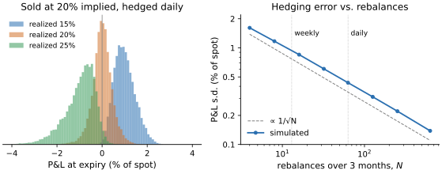

# Lab 10 · 卖期权，卖的是什么

> 难度 ★★★★☆ · 预计 3–4 小时 · 前置：lab03（信号还是噪声，尤其 §2 负偏度）

Black-Scholes 公式本身几行代码，AI 可以随手写出来，Greeks 也一样。真正要懂的是另外几件事：
期权价格到底在给什么定价；对冲之后剩下的风险是什么；BS 的假设在现实中从哪里开始失效；
以及为什么“卖期权”这类策略的回测几乎总是看起来很好，直到某一天不是。

本 lab 由三部分组成：

1. **讲义**（本文件）。
2. **审计**（[`audit.py`](audit.py)）：一份“稳定赚取波动率风险溢价、建议上线”的卖期权回测，里面有会让结论偏乐观的错误。
3. **思考题**。

定价、Greeks、隐含波动率、蒙特卡洛、对冲模拟都已经实现好了，在 `quantlab.options` 里。

---

## 1. 期权价格是对“未来波动”的报价

BS 的核心不是那个公式，而是**复制论证**：持有一份看涨期权，同时做空 $\Delta = \partial V/\partial S$
份标的，组合在下一瞬间对标的的小幅变动不敏感。不断调整 $\Delta$，这个组合就是无风险的，
所以它只能赚无风险利率。由此推出 BS 偏微分方程：

$$
\frac{\partial V}{\partial t} + \tfrac12 \sigma^2 S^2 \frac{\partial^2 V}{\partial S^2} + rS\frac{\partial V}{\partial S} - rV = 0
$$

| 符号 | 含义 |
| --- | --- |
| $V(S, t)$ | 期权价格，是标的价格和时间的函数 |
| $S$ | 标的当前价格 |
| $t$ | 当前时间，以**年**为单位（距到期还剩 $T - t$ 年） |
| $\sigma$ | 标的的**年化**波动率（对数收益的标准差，按年计），BS 假设它是常数 |
| $r$ | **年化**连续复利的无风险利率 |
| $\partial V/\partial S$ | 即 $\Delta$（delta）：标的每变动 1 元，期权价格变动多少，也是对冲时持有的标的份数 |
| $\partial^2 V/\partial S^2$ | 即 $\Gamma$（gamma）：delta 随标的价格变化的速度，单位是“每元”的 delta 变化 |
| $\partial V/\partial t$ | 即 $\Theta$（theta）：其他不变，仅时间流逝带来的价格变化（按年计） |

各项的含义：时间流逝（$\Theta$）加上价格随机波动带来的凸性收益（$\tfrac12\sigma^2S^2\Gamma$），
再加上对冲头寸的融资（$rS\Delta - rV$），合起来必须为零——否则就有无风险套利。
标的有连续股息率 $q$ 时（`quantlab.options` 的定价函数支持），第三项中的 $r$ 换成 $r - q$。

注意方程里**没有标的的期望收益 $\mu$**。看多也好、看空也好，同一份期权的价格是一样的，
因为期权的风险可以被标的对冲掉，对 $\mu$ 的看法不影响复制成本。方程里唯一无法观测的参数是 $\sigma$。
在合成数据上模拟可得：卖出 1 年期平值看涨（$S_0=100$），按真实波动率 20% 每日对冲，标的年化漂移为 0%、+30%、-30% 时，
对冲后 P&L 的均值分别是 -0.002、-0.028、-0.018（权利金约 8），都接近 0。

所以期权市场交易的其实是**波动率**。把市场价格代回 BS 公式反解出的 $\sigma$，就是**隐含波动率**：
市场对期权存续期内波动率的报价（再加上风险溢价，见 §4）。

## 2. 对冲之后还剩下什么：gamma 与 theta 的交换

现实中只能离散地对冲。卖出一份期权、每隔 $\Delta t$ 对冲一次，一个周期内的 P&L 约为

$$
\text{P\&L} \approx \tfrac12\,\Gamma S^2 \left(\sigma_{\text{impl}}^2 \Delta t - (\Delta S/S)^2\right)
$$

| 符号 | 含义 |
| --- | --- |
| $\text{P\&L}$ | 期权**卖方**（已做 delta 对冲）在这一个对冲周期内的盈亏，以元计；忽略利率 |
| $\Gamma$ | 期权在周期开始时的 gamma（按 $\sigma_{\text{impl}}$ 计算），恒为正；卖方承担的是 $-\Gamma$ |
| $S$ | 周期开始时的标的价格 |
| $\Delta S$ | 这一个周期里标的价格的变化，$\Delta S/S$ 就是这个周期的标的收益 |
| $\Delta t$ | 对冲周期的长度，以**年**为单位（每天对冲一次时约为 $1/252$） |
| $\sigma_{\text{impl}}$ | 卖出期权时的**年化**隐含波动率，也是计算 delta 用的波动率 |

$\sigma_{\text{impl}}^2\Delta t$ 是按隐含波动率“预期”的这一周期收益的方差，$(\Delta S/S)^2$ 是实际发生的那一次。
实际波动大于预期就亏，小于预期就赚。

直觉是：卖方每天收取 theta（时间价值衰减，约等于 $\tfrac12\Gamma S^2\sigma_{\text{impl}}^2\Delta t$），
同时承担 gamma 损失（标的每动一次，delta 对冲就“买高卖低”一次，损失约 $\tfrac12\Gamma (\Delta S)^2$）。
把整个存续期加起来：

$$
\text{P\&L}_{\text{卖方}} \approx \int_0^T \tfrac12\,\Gamma_t S_t^2 \left(\sigma_{\text{impl}}^2 - \sigma_{\text{real},t}^2\right) dt
$$

这里 $T$ 是期权的存续期（年），$\Gamma_t$ 和 $S_t$ 是 $t$ 时刻的 gamma 和标的价格，
$\sigma_{\text{real},t}$ 是 $t$ 时刻标的**实际**的瞬时波动率（年化）。把上一个式子中每个周期的
$(\Delta S/S)^2$ 换成它的期望 $\sigma_{\text{real},t}^2\,\Delta t$，再对所有周期求和（$\Delta t \to dt$），就得到这个积分。

由此得到三个结论：

1. **卖方赚的是隐含波动与实现波动之差。** 实现波动低于卖出时的隐含波动就赚，高于就亏，和标的涨跌方向无关。
   在合成数据上模拟可得：按 20% 卖出 3 个月平值跨式、每日对冲，P&L（占标的初始价格的百分比）为

   | 实现波动 | P&L 均值 | 亏钱路径占比 |
   | --- | --- | --- |
   | 15% | +1.99% | 0% |
   | 20% | -0.00% | 50% |
   | 25% | -1.99% | 98% |

   和粗略估计 $\text{vega}\times\Delta\sigma = 39.8 \times 0.05 = 1.99\%$ 一致。这里 vega 是跨式组合价格对
   波动率的敏感度（波动率变动 1.0、即 100 个百分点时价格变动 39.8 元，标的价格 100），
   $\Delta\sigma = 0.05$ 是隐含与实现波动之差（20% − 15%），乘积 1.99 元即标的价格的 1.99%。
2. **P&L 是路径依赖的。** 权重是 $\Gamma_t S_t^2$，而 gamma 在平值附近、临近到期时最大。
   同样的实现波动，如果大波动恰好发生在标的贴近行权价、离到期还剩几天的时候，亏得最多。
3. **离散对冲的误差约按 $1/\sqrt{N}$ 缩小**（$N$ 为对冲次数）。对冲越频繁，误差越小，但交易成本越高。
   现实中的对冲频率是误差和成本之间的权衡。模拟可得：3 个月平值跨式、用正确的波动率对冲，
   P&L 的标准差在每周对冲时是 1.869%，每天对冲 0.877%，每天 10 次 0.278%——每次对冲频率提高约 5–10 倍，
   误差缩小约 $\sqrt{5}$ 到 $\sqrt{10}$ 倍。



*图：卖出一份 3 个月平值**看涨**期权（上表是跨式，大约相当于两份，所以这里的数字约为上表的一半），
按 20% 的隐含波动收取权利金并用它计算 delta，各模拟 20000 条路径，P&L 以标的初始价格的百分比计。
左图每天对冲：实现波动 15%、20%、25% 时，P&L 均值分别为 +1.00%、+0.01%、−0.99%，亏钱路径占 0%、49%、98%——
三个分布几乎不重叠，结论 1 所说的“赚的是隐含与实现之差”一目了然；即使实现波动恰好等于 20%，
单条路径的 P&L 也有 0.44% 的标准差，这是离散对冲和路径依赖（结论 2）留下的。
右图用正确的波动率对冲，横轴是 3 个月内的对冲次数（对数坐标）：从 4 次的 1.61% 降到 630 次的 0.14%，
在对数坐标上是一条斜率 −0.49 的直线，与虚线 $1/\sqrt{N}$ 平行（结论 3）。每天对冲（63 次）时是 0.44%。*

## 3. BS 在什么时候失效

BS 假设：价格连续变动（没有跳跃）、波动率是常数、可以无成本地连续交易。三条都不成立。

- **跳跃。** 一夜之间跌 10% 的时候，你根本来不及调整 delta。跳跃造成的损失**不会因为对冲更频繁而减少**。
  这是期权卖方最根本的、无法对冲的风险。模拟可得：加入向下跳跃（每年约 2 次、每次约 -6%），扩散波动 18%，
  按 22% 卖出跨式：

  | 对冲频率 | P&L 均值 | 标准差 | 最差 1% 的均值 |
  | --- | --- | --- | --- |
  | 每周 | +0.74% | 2.40% | -8.65% |
  | 每天 | +0.76% | 1.85% | -7.64% |
  | 每天 10 次 | +0.76% | 1.68% | -7.32% |

  没有跳跃时，从每天到每天 10 次能把标准差压掉约 2/3；有跳跃时只降了约 10%，尾部亏损几乎不变。
- **随机波动率。** 波动率本身会变，而且和价格负相关：大跌往往伴随波动率飙升。卖方在最差的时刻会同时遭受两种打击：
  标的大跌造成 gamma 损失，隐含波动率上升又造成 vega 损失（盯市亏损）。
- **交易成本和流动性。** 对冲本身要花钱；期权的买卖价差通常远大于标的，深度虚值期权的价差可能是中间价的一大部分。

**波动率微笑（偏斜）就是市场对这些失效的定价。** 如果 BS 是对的，同一到期日、不同行权价的期权，
隐含波动率应该一样。实际上在股指期权市场，低行权价的看跌期权隐含波动率明显更高。
原因之一就是向下的跳跃：深度虚值看跌期权恰好是对崩盘的保险，而 BS 的正态分布严重低估了崩盘的概率。
在一个扩散波动 15%、每年约 1 次 -10% 跳跃的世界里，用蒙特卡洛算出 3 个月看跌期权的公平价格，
再用 BS 反解隐含波动率：行权价 75 时是 23.0%，平值（100）是 17.8%，行权价 120 时是 15.9%。
仅仅因为跳跃的存在，就出现了向左倾斜的“微笑”。
1987 年股灾之后，这个偏斜就再也没有消失过。

## 4. 卖期权在卖什么：波动率风险溢价

实证上，股指期权的隐含波动率**平均**高于事后实现的波动率，这个差额叫**波动率风险溢价**（VRP）。
于是系统性地卖出期权、对冲掉 delta，长期平均是赚钱的。

用 lab03 §5 的问题来审视它：

- **钱是谁给的？** 需要下行保护的投资者：养老金、保险资金、有回撤约束的机构。他们愿意为保险付出高于“精算公平价”的价格，
  就像人们愿意为房屋保险付钱一样。
- **为什么没有被套利掉？** 因为卖保险的人要承担真实的风险。这份风险集中在最坏的时刻（市场崩盘、流动性枯竭、
  所有资产同时下跌），而且需要大量保证金。大多数资金在这种时刻恰恰最承受不起亏损。
  **溢价是对承担这种风险的补偿，不是免费的午餐。**
- **什么时候失效？** 崩盘时。2008 年、2018 年 2 月（“Volmageddon”，几只做空波动率的产品一天之内几乎归零）、2020 年 3 月。

所以卖期权策略的收益分布是典型的“卖保险”形状：大部分时间小赚，偶尔大亏，**严重负偏**。回顾 lab03 §2：

- 在一段没有发生崩盘的历史上，它的样本 Sharpe 会高得离谱。模拟可得：在有向下跳跃的世界里每季度卖一次跨式
  （隐含 22%、扩散 18%），4000 个季度里 79% 赚钱，偏度 -1.7，全样本年化 Sharpe 0.84；
  而在恰好没有跳跃的 3 年里，年化 Sharpe 的中位数是 **2.25**；
- 负偏度让 Sharpe 的标准误比 iid 公式算出来的大；
- 用正态分布估计尾部风险（VaR、CVaR）会系统性地低估亏损。

**看到一个 Sharpe 很高、回撤很小的策略，先问：它的收益是不是来自卖出某种保险？**
卖期权是最直接的一种。其他形式还包括套息交易、卖出信用违约保护、某些“低风险”的统计套利，
以及任何靠“多数时候不会发生”赚钱的策略。

## 5. 回测卖期权策略时特有的陷阱

- **隐含波动率数据。** 历史隐含波动率数据贵且不全，研究者常用已实现波动率代替。代替时用的是哪个窗口的已实现波动率，决定了回测是否偷看了未来。
- **崩盘被“清洗”掉。** 卖期权策略的风险集中在少数几天里。按“超过几个标准差就是异常值”的规则清洗数据，删掉的恰恰是最重要的那几天。
- **成交价。** 按中间价成交在期权上尤其不现实。卖出成交在买价，价差可能占权利金的相当比例。
- **盯市和保证金。** 只在到期日结算 P&L，会隐藏存续期内的浮亏。现实中浮亏会触发保证金追缴，
  可能在最坏的时刻被迫平仓，而回测里那份期权到期时也许已经回本了。
- **样本期。** 样本里有没有包含一次真正的危机，对结论的影响可能超过其他所有因素。

## 6. 工具的局限

- BS 的 Greeks 是在 BS 模型下算的。模型错了（有跳跃、有随机波动率），delta 就不是最优对冲比例，对冲效果会打折扣。
- 隐含波动率是**一个**数字，市场价格包含的信息远多于它：整条微笑曲线、期限结构，都在反映对跳跃和波动率变化的定价。
- 风险溢价的大小本身随时间变化，危机后通常更高，平静期更低。“平均 VRP”可能对你实际交易的那段时间并不适用。

---

## 审计

打开 [`audit.py`](audit.py)。那份结论是“卖出 delta 对冲的跨式期权，Sharpe 约 2，尾部风险在限额之内，建议上线”。

1. **先不要跑测试。** 读代码，把你发现的问题写进文件开头的「审计记录」。§5 列出的陷阱是一个好的起点，但不是每一条都在这份代码里。
2. 逐个修正。
3. 运行测试：

   ```bash
   make test LAB=10
   ```

修正之后看看 `evaluate` 的结果：Sharpe、偏度、最差月份、CVaR 都变成了什么？这才是这个策略真实的样子。
它不是一个坏策略，波动率风险溢价是真实存在的，但它需要被正确地理解、定价和控制规模。

## 思考题

1. 审计题的测试里有一条注释：暴跌之后的**下一份**期权会以很高的价格卖出，部分抵消损失。
   这在现实中成立吗？什么情况下卖方根本活不到下一份期权？（提示：保证金、杠杆、赎回。）
2. 一个基金经理说：“我只卖深度虚值的看跌期权，到期时几乎总是作废，胜率 95%。”
   用 §3、§4 的知识，说说这个策略的风险在哪里，以及 95% 的胜率意味着什么。
3. 如果每个人都知道波动率风险溢价的存在，为什么它没有消失？列出至少三个原因，并说明哪个原因最可能在未来减弱。
4. 你让 AI 回测一个期权策略，它报告了一条非常平滑的净值曲线。按重要性排序，列出你会追问的问题。

## 拓展：真实数据

中证 50ETF 期权、沪深 300 股指期权都有公开的行情数据（akshare 提供接口）。
找一段包含 2015 年股灾或 2020 年 3 月的历史，比较平值期权的隐含波动率与事后 21 天的实现波动率，
画出两者之差（VRP）的时间序列。它在危机前后是怎么变化的？

## 参考文献

- Black, F. & Scholes, M. (1973). *The Pricing of Options and Corporate Liabilities.* Journal of Political Economy.
- Merton, R. (1976). *Option Pricing When Underlying Stock Returns Are Discontinuous.* Journal of Financial Economics.
- Carr, P. & Wu, L. (2009). *Variance Risk Premiums.* Review of Financial Studies.
- Bakshi, G. & Kapadia, N. (2003). *Delta-Hedged Gains and the Negative Market Volatility Risk Premium.* Review of Financial Studies.
- Sinclair, E. (2013). *Volatility Trading.* Wiley.
- Taleb, N. N. (1997). *Dynamic Hedging.* Wiley.
