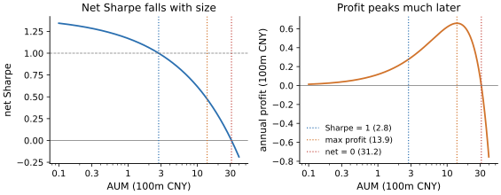
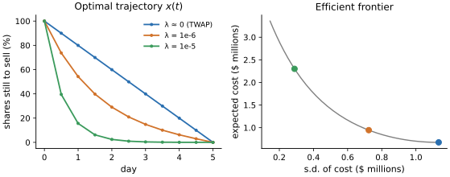

# Lab 11 · 纸面 alpha 能剩下多少

> 难度 ★★★★☆ · 预计 3 小时 · 前置：lab02（向量化回测、换手）、lab03（信号还是噪声）

回测里的收益是“如果我能按收盘价成交任意数量”的收益。现实中，每一笔交易都会推动价格，
交易越大推得越多；大单需要时间执行，而信号在执行期间不断衰减。这些成本随规模**非线性**地增长，
所以同一个策略，管 1000 万和管 10 亿是两个完全不同的生意。

这一课要建立的判断是：**一个策略能装多少钱，以及纸面 Sharpe 在实盘中会剩下多少。**
这类分析很容易被写错，而且写错的方向几乎总是乐观的。

本 lab 由三部分组成：

1. **讲义**（本文件）。
2. **审计**（[`audit.py`](audit.py)）：一份“5 亿规模扣成本后净 Sharpe 1.4、容量超过 20 亿”的分析，里面有会让成本被低估的错误。
3. **思考题**。

TWAP、VWAP、Almgren-Chriss 最优轨迹、成本的期望和方差、执行模拟都已经实现好了，在 `quantlab.execution` 里。

---

## 1. 交易成本的三个组成部分

一笔交易相对“决定交易时的价格”（arrival price）付出的总成本叫 **implementation shortfall**。它大致由三部分组成：

1. **价差。** 买在卖价、卖在买价。固定成本，和交易规模基本无关，小单的主要成本。
2. **市场冲击。** 你的买单消耗了卖方的挂单，推高了价格。大单的主要成本。
3. **择时与机会成本。** 执行需要时间，这段时间里价格会自己变动；如果因为担心冲击而没有执行完，没成交的部分就错过了 alpha。

市场冲击的经验规律非常稳健，在不同市场、不同年代、不同资产类别上都成立，这就是**平方根冲击律**：

$$
\frac{\text{冲击成本}}{\text{成交金额}} \approx Y\,\sigma\,\sqrt{\frac{Q}{V}}
$$

| 符号 | 含义 |
| --- | --- |
| 冲击成本 / 成交金额 | 每成交 1 块钱付出的冲击成本，即成交均价相对决策时价格（arrival price）的不利偏离，以比例表示 |
| $Q$ | 你在这一天的成交额（只算这只股票） |
| $V$ | 这只股票当天全市场的成交额，与 $Q$ 同一单位；$Q/V$ 就是**参与率** |
| $\sigma$ | 这只股票的**日**收益波动率（不是年化），如 2% |
| $Y$ | 经验系数，无量纲，量级为 1，需要用自己的成交记录校准（§5） |

取 $Y=0.8$、日波动 2%：

| 参与率 $Q/V$ | 1% | 4% | 16% | 25% |
| --- | --- | --- | --- | --- |
| 每块钱的冲击成本 | 16 bps | 32 bps | 64 bps | 80 bps |
| 总成本（占当日成交额 $V$ 的万分比） | 0.16 | 1.28 | 10.24 | 20.00 |

几个推论：

- 每块钱的成本随规模的**平方根**增长：单子放大 4 倍，每块钱的成本翻倍，**总成本**变成 8 倍。
- 成本和波动率成正比：同样的参与率，交易高波动的股票更贵。
- 没有“小到可以忽略”的冲击：参与率 1% 时，成本也有十几个基点。

为什么是平方根而不是线性？一个直觉：市场上潜在的流动性（还没挂出来的单子）是逐渐“被你的交易唤醒”的，
你推得越远，引来的对手方越多，所以价格对累计成交量的反应是凹的。这仍然是一个活跃的研究领域，但这条经验规律本身很少被推翻。

## 2. 容量：不只是“能不能做”，而是“做多大”

把成本加进收益，一个策略在规模 $A$ 下每年的净收益率约为

$$
r_{\text{net}}(A) = \alpha - 252\,\tau_d\Big(s + Y\sigma\sqrt{\tfrac{\tau_d A}{N V}}\Big)
$$

| 符号 | 含义 |
| --- | --- |
| $A$ | 策略规模（AUM），以元计 |
| $r_{\text{net}}(A)$ | 规模为 $A$ 时扣除成本后的**年化**收益率 |
| $\alpha$ | 纸面（扣费前）的**年化**收益率 |
| $\tau_d$ | **每天**的双边换手：当天买入额加卖出额，占 AUM 的比例（例如 10%）。乘以 252 得到每年的换手 |
| $N$ | 交易的股票数。假设每天的成交额平均分摊到 $N$ 只股票上，每只每天成交 $\tau_d A / N$ |
| $V$ | 每只股票的**日**成交额 |
| $\tau_d A/(NV)$ | 每只股票每天的参与率，就是 §1 平方根律里的 $Q/V$ |
| $s$ | 半个买卖价差（比例，如 3bps = 0.0003），每成交 1 块钱付一次 |
| $\sigma,\ Y$ | 日波动率和冲击系数，同 §1 |

括号里是每成交 1 块钱的成本（价差加冲击），乘以每年的成交额占 AUM 的比例 $252\,\tau_d$，就是每年的成本率。
注意平方根里必须用**每天**的换手去和**每天**的成交额比；把年换手放进去，参与率会被放大 252 倍。
净收益率随规模单调下降。但“容量”有几种不同的定义，它们给出的数字差别很大：

| 定义 | 含义 | 谁关心 |
| --- | --- | --- |
| 净 Sharpe 降到某个门槛（比如 1.0）的规模 | 风险调整后的收益还值得做 | 投资者 |
| 年利润（$r_{\text{net}} \times A$）最大的规模 | 管理人能赚到最多钱 | 管理人 |
| 净收益率归零的规模 | 再大就是纯亏 | 没有人应该到这里 |

一个算例：纸面年化收益 15%、波动 10%（Sharpe 1.5），每天双边换手 10%，交易 50 只股票，每只日成交额 5000 万，
半价差 3 bps，冲击按上表的平方根律。三种容量分别是：

| 定义 | 规模 |
| --- | --- |
| 净 Sharpe ≥ 1.0 的最大规模 | 2.7 亿 |
| 年利润最大的规模（此时净 Sharpe 0.48） | 13.8 亿 |
| 净收益率归零的规模 | 30.7 亿 |

利润最大的规模通常**远大于** Sharpe 门槛对应的规模，这里是 5 倍。管理人和投资者的利益在这里是不一致的，这也是很多策略“规模做大之后变平庸”的原因之一。



*图：按上面的公式和算例参数画出净 Sharpe（左）和年利润（右）随规模的变化，横轴是对数坐标，单位亿元。
三条竖线依次是：净 Sharpe 降到 1 的 2.8 亿、年利润最大的 13.9 亿（此时净 Sharpe 只剩 0.47，年利润约 6600 万）、
净收益归零的 31.2 亿（与上表的 30.7 亿相差不到 2%）。左图的净 Sharpe 从一开始就在下降，
右图的利润却一直上升到 13.9 亿才见顶：规模每扩大一点，投资者拿到的风险调整收益都在变差，管理人的总利润却还在增加。*

容量估计对几个输入特别敏感：

- **换手率。** 成本和换手成正比，冲击又随换手的平方根增长。高换手策略的容量通常很小。
- **流动性估计。** 成交额的分布严重右偏：指数调仓日、消息日的成交额可能是平时的几十倍。
  用均值估计“每天能成交多少”会系统性地高估流动性。
- **冲击系数从哪里来。** 用你自己的成交记录校准是最好的，前提是成本的衡量方式正确（§5）。

## 3. 执行需要时间，alpha 不等人

为了控制冲击，大单通常要拆开执行，并限制参与率（比如不超过当日成交额的 5%–10%）。单子越大，需要的天数越多。
而信号的预测能力是会衰减的：短周期的反转、事件驱动类信号，alpha 的半衰期可能只有一两天。

如果 alpha 的半衰期是 $h$ 天，一笔需要 $d$ 天执行完、每天执行相同份额的交易，平均只能吃到

$$
\frac{1}{d}\sum_{k=0}^{d-1} 2^{-k/h}
$$

的 alpha。这里假设信号的 alpha 按指数衰减：$k$ 是从决定交易那天起算的第几天（$k=0$ 是当天），
那天成交的部分只能吃到 $2^{-k/h}$ 的 alpha（$k=h$ 时剩一半）；每天成交 $1/d$ 的份额，所以对 $d$ 天取平均。半衰期 $h=2$ 天时，分 1、2、4、8 天执行，分别能吃到 100%、85%、64%、40%。
所以规模变大时，成本上升，**收益本身也在下降**。这就是“纸面 alpha 到实盘的衰减”的第二个来源。

这也解释了为什么换手低、信号衰减慢的策略（比如价值、质量类因子）容量大，
而高频、短周期的策略容量小：后者每一块钱的 alpha 都更依赖于成交速度。

## 4. 最优执行：在冲击和风险之间取舍

给定要卖出 $X$ 股、期限 $T$，怎么安排执行节奏？

- 卖得**快**：冲击成本高（每个区间成交多），但执行期间暴露在价格波动下的时间短，成本的不确定性小。
- 卖得**慢**：冲击成本低，但价格风险大。

Almgren-Chriss (2000) 用均值方差框架形式化了这个取舍：最小化 $\mathbb{E}[\text{成本}] + \lambda\,\mathrm{Var}[\text{成本}]$。
在线性冲击的假设下，最优持仓轨迹有闭式解：

$$
x(t) = X\,\frac{\sinh\big(\kappa(T-t)\big)}{\sinh(\kappa T)}, \qquad \kappa \approx \sqrt{\frac{\lambda\sigma^2}{\eta}}
$$

| 符号 | 含义 |
| --- | --- |
| $X$ | 要卖出的总股数 |
| $T$ | 执行期限（例子里以天计） |
| $t$ | 从开始执行起经过的时间，$0 \le t \le T$ |
| $x(t)$ | $t$ 时刻**还没卖出**的股数：$x(0)=X$，$x(T)=0$；单位时间卖出的速度是 $-dx/dt$ |
| $\lambda$ | 风险厌恶系数，单位是 1/元：愿意为降低 1 单位成本方差多付多少期望成本 |
| $\sigma$ | 股价的波动率，以**价格**计（元 / $\sqrt{\text{天}}$），例子里是每天 0.95 美元，不是收益率 |
| $\eta$ | 临时冲击系数：以速度 $v$（股/天）卖出时，每股成交价被压低约 $\eta v$ |
| $\kappa$ | “紧迫度”（1/天）：轨迹衰减的速度，$\kappa T$ 越大越前置 |
| $\sinh$ | 双曲正弦，$\sinh z = (e^z - e^{-z})/2$；$z$ 很小时 $\sinh z \approx z$，轨迹退化为直线 |

模型还有一个永久冲击系数 $\gamma$（每卖出 1 股，价格永久下移 $\gamma$），它影响期望成本；在连续时间近似下不影响最优轨迹的形状。
$\kappa$ 的式子是连续时间下的近似；`quantlab.execution.ac_kappa` 用的是离散时间的精确版本，
其中 $\eta$ 换成 $\eta - \tfrac12\gamma\tau$（$\tau$ 为每个交易区间的长度）。

$\lambda \to 0$ 时退化为 TWAP（匀速卖出，期望成本最低）；$\lambda$ 越大，执行越前置。
不同 $\lambda$ 下的（期望成本、方差）组合构成一条**有效前沿**。用原文的例子（5 天内卖出 100 万股，股价 50，日波动 0.95 美元）：

| $\lambda$ | 期望成本（美元） | 成本标准差（美元） | 第一天卖出比例 |
| --- | --- | --- | --- |
| 1e-9（≈ TWAP） | 675,001 | 1,133,239 | 20% |
| 1e-6 | 945,216 | 723,822 | 46% |
| 1e-5 | 2,300,817 | 288,990 | 84% |

把标准差压到约 1/4，代价是期望成本变成 3.4 倍。



*图：同一个例子，每半天一个交易区间。左图是三种风险厌恶下还没卖出的股数 $x(t)$：$\lambda\approx 0$ 是匀速的 TWAP，
第一天卖 20%；$\lambda=10^{-6}$ 第一天卖 46%；$\lambda=10^{-5}$ 第一天就卖掉 84%，曲线就是 $\sinh$ 形状的衰减。
右图的灰线是所有 $\lambda$ 对应的（成本标准差、期望成本）组合，三个点就是左图的三条轨迹：
从右下的 TWAP（期望 67.5 万、标准差 113 万）沿着前沿往左上走，标准差降到 29 万，期望成本升到 230 万。
前沿上没有“又便宜又稳”的点，只有在两者之间选。*

几个现实提醒：

- 前置执行降低的是成本的**方差**，代价是更高的**期望**成本。在大多数单次执行中，它都会比 TWAP 更贵。
  用上面的参数各模拟 20000 次：$\lambda=10^{-5}$ 的前置轨迹在 96% 的模拟里比 TWAP 更贵；
  平均成本 2,303,570 对 687,323，最差 5% 的平均成本 2,901,467 对 3,018,637。
  它是为最坏的情况买的保险，而不是一个更便宜的方法。
- 模型假设冲击是线性的、价格是算术随机游走、参数已知。实际上冲击接近平方根形式，参数需要估计，
  市场会对你的交易做出反应（别人看到持续的卖压会提前卖出）。这个闭式解是一个出发点，不是答案。
- VWAP 排程（按历史成交量曲线分配）在实践中最常用，因为它让你的成交混在市场的自然流动性里。

## 5. 怎样衡量你实际付出了多少

执行完成之后，怎么知道成本是多少？常见的基准有：

| 基准 | 衡量的是 | 问题 |
| --- | --- | --- |
| **决策时的价格（arrival）** | 从决定交易到交易完成的全部代价：冲击、择时、价差 | 噪声大（包含执行期间与你无关的价格变动），需要很多样本才能估计准 |
| **当天的市场 VWAP** | 你的成交价相比当天市场平均成交价好不好 | **你自己的交易就在 VWAP 里。** 你推高了价格，其他人也在被推高的价格上成交，VWAP 跟着你一起移动。参与率越高，这个基准越看不到你自己的冲击 |
| 收盘价 | 适合以收盘价计算净值的基金 | 和 VWAP 类似，也会受你自己交易的影响 |

VWAP 适合评估“执行算法在给定的一天里做得好不好”，**不适合**估计“这个规模的交易一共要花多少钱”。
用 VWAP 滑点去校准冲击模型、再用这个模型估算容量，会得出一个严重偏乐观的容量（审计题里就有这个错误）。

在合成的 400 笔母单执行记录上（真实冲击按平方根律生成），按参与率分组比较两种成本：

| 参与率 | 相对 arrival（bps） | 相对 VWAP（bps） |
| --- | --- | --- |
| 0–5% | 11.3 | 5.3 |
| 5–10% | 43.1 | 8.5 |
| 10–20% | 62.1 | 11.0 |
| 20–25% | 100.5 | 12.3 |

参与率越高，相对 arrival 的成本涨得越快，而 VWAP 滑点几乎不动：在 20% 以上的单子里，VWAP 只看到了约 1/8 的真实成本。

## 6. 工具的局限

- 冲击模型的参数是在你**过去**的交易规模下估计的。外推到大得多的规模，就是在用模型最没有数据支撑的部分做决策。
- 冲击会随市场状态变化。在危机中流动性会枯竭，$Y$ 和 $\sigma$ 会同时变大，而这恰恰是你最需要交易的时候。
- 多个策略、多个管理人交易同一类信号时（拥挤），他们的冲击会叠加。你的容量取决于别人在做什么，而这一点几乎无法观测。

---

## 审计

打开 [`audit.py`](audit.py)。那份结论是“5 亿规模扣成本后净 Sharpe 1.4 以上，容量超过 20 亿，建议上线”。

1. **先不要跑测试。** 读代码，把你发现的问题写进文件开头的「审计记录」。
2. 逐个修正。
3. 运行测试：

   ```bash
   make test LAB=11
   ```

修正之后，看看校准出的冲击系数、每年的成本、5 亿规模的净 Sharpe 和容量分别变成了多少。

## 思考题

1. 修正后的容量大约是多少？如果你是这个策略的管理人，你会把规模设在哪里？如果你是投资者呢？两个答案为什么不同？
2. 有人提议：“把换手从每天 10% 降到 5%，纸面 Sharpe 从 1.5 降到 1.3，但成本减半，净 Sharpe 更高。”
   在什么条件下这个提议是对的？你需要知道信号的什么性质才能判断？
3. 平方根冲击律意味着把一笔大单拆给 4 个经纪商同时执行，并不能降低总冲击。为什么？
4. 你让 AI 帮你估算一个策略的容量，它直接按“日均成交额 × 10% × 股票数 / 换手率”算出一个数。
   这个算法隐含了哪些假设？和本 lab 的分析相比，它会高估还是低估？

## 拓展：真实数据

```python
from quantlab import realdata

df = realdata.a_share_daily("600519", adjust="")  # 贵州茅台，不复权（要算真实成交额）
value = df["volume"] * 100 * df["close"]  # akshare 的成交量单位是“手”（100 股）
```

看一下成交额的分布：均值与中位数之比是多少？哪些日子是放量日？
如果你的策略要在这只股票上每天交易 1000 万，参与率是多少？按平方根律估算成本大约多少个基点？

## 参考文献

- Almgren, R. & Chriss, N. (2000). *Optimal Execution of Portfolio Transactions.* Journal of Risk.
- Kissell, R. (2013). *The Science of Algorithmic Trading and Portfolio Management.* Academic Press.
- Tóth, B. et al. (2011). *Anomalous Price Impact and the Critical Nature of Liquidity in Financial Markets.* Physical Review X.
- Frazzini, A., Israel, R. & Moskowitz, T. (2018). *Trading Costs.* Working paper, AQR.
- Bouchaud, J.-P., Bonart, J., Donier, J. & Gould, M. (2018). *Trades, Quotes and Prices.* Cambridge University Press.
- Perold, A. (1988). *The Implementation Shortfall: Paper versus Reality.* Journal of Portfolio Management.
